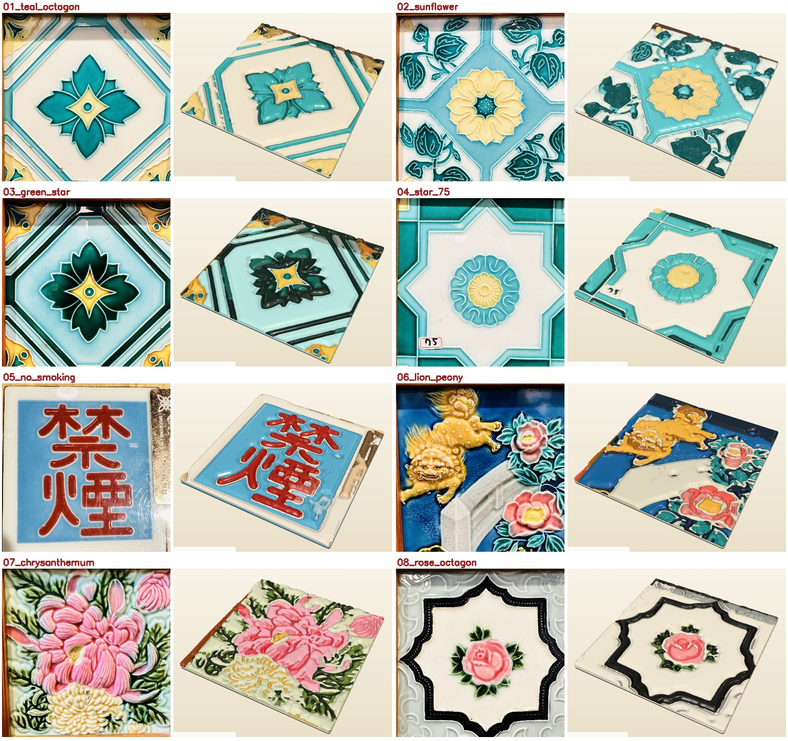

# tw-tile-gen · 花磚 3D relief generator

Turn a phone photo of a traditional Taiwanese majolica tile (花磚) into a watertight, multi-colour 3D relief (`.3MF`, optional `.GLB`) ready for multi-material 3D printing.

**Live app:** https://mixocreative.github.io/tw-tile-gen/
**Backend:** Python on Google Cloud Run (free tier). The URL is set in `frontend/index.html` (`DEFAULT_API`).



---

## What it does

1. **Capture.** Snap or upload a photo of a tile. The photo is never stored.
2. **Outline.** On-device AI (Google AI Edge / MediaPipe Interactive Segmenter) suggests the tile's four corners.
   - Drag the yellow handles to fine-tune; a magnifier appears while you drag. A manual edit always wins over the AI.
   - Or switch to **Square crop** (Cropper.js). This is also the automatic fallback if the AI model can't load.
3. **Colours.** Tap glaze colours on the flattened tile with the eyedropper, or leave it on **auto**, which picks 3–8 colours.
4. **Proportions.** Set the tile size and relief settings. The defaults are tuned for a realistic 150 mm tile.
5. **Generate.** A real progress bar shows the server's actual stages. The 3D preview opens as soon as the shape is ready, while the printable file finishes.
6. **Download** a `.3MF`. It's one object with one named part per colour, each pre-assigned its own extruder; it opens in PrusaSlicer, OrcaSlicer and Bambu Studio. `.GLB` is optional.

## How the relief is built (design decisions)

These rules came out of many review rounds with the owner. Keep them unless the owner changes them.

| Rule | Why |
|---|---|
| **Every colour is equal.** There is no "background" colour and no height tiers by colour. | A photo doesn't tell you which colour is the ground. |
| **Carve the edges.** Every colour starts at the shared full height; the surface then rolls down smoothly into a soft V-valley at each seam. | On a real tile, glaze fields sit level and only the edges round off. Two neighbouring rectangles give a lowercase **"m"** in cross-section. |
| **Big areas are near-level**, with a gentle crown that flattens as the area grows. Thin strokes stay lower and round. | Looks like pressed, glazed ceramic. |
| **Raised outlines (tube-lining).** Thin light or dark lines are found on the photo itself and become a smooth 0.8 mm ridge. | They are the signature of majolica tiles and are often almost the same colour as their neighbour. |
| **Puzzle-piece borders.** All colours are cut from one shared partition, so neighbours meet exactly with no gap and no overlap. An optional **clearance** leaves a slot between pieces. | Clean multi-material prints; print pieces separately if you like. |
| **Watertight bodies.** Every part is a closed, manifold mesh, checked on every change. | Slicers need it. |

Pipeline (`backend/tile_processor.py`):

```
photo ─► perspective warp (4 corners, 1.5 % inset) ─► colours: bilateral + mean-shift,
k-means (12) in L-weighted Lab, merge shading bands, auto-k (≤ 8) ─► clean-up: majority filter,
speck removal (keeps long thin strokes and high-contrast details), highlight absorb
─► outline detection (morphological top/black-hat on L, skeleton, ridge distance)
─► shared partition φᵢ = (dᵢ − min over other colours dⱼ)/2 ─► per colour: screened-Poisson seam distance →
"carve the edges" height field + outline ridge ─► marching cubes ─► manifold-checked decimation
─► backing pad (rounded slab) ─► .3MF (PrusaSlicer-family part table) / .GLB
```

### Default settings (150 mm tile)

| Setting | Default | Meaning |
|---|---|---|
| Tile width | 150 mm | Historic 6-inch majolica size. Changing it re-tunes the relief settings below in proportion. |
| Max height cap | width ÷ 10 | Never taller than this. |
| Backing pad | 3.0 mm | Base slab. |
| Edge depth | 3.0 mm | How far each colour rolls down into its seams. |
| Edge roll width | 6.0 mm | Seam to full height. Wider gives a softer valley. |
| Top crown | 1.0 mm | Gentle dome; leveler on bigger areas. |
| Groove floor | 0.4 mm | Material under the seams (2 print layers). |
| Raised outlines | 0.8 mm high, 1.2 mm wide | 0 turns it off. |
| Clearance between colours | 0 mm | 0 is a flush fit; e.g. 0.3 leaves slots. |
| Max colours | 8 | Auto picks 3 up to this. |
| Mesh smoothness | 0.16 mm | Finer than this runs out of memory on a 2 GiB Cloud Run instance, so the server enforces it. |

A 150 mm tile is about 7 mm tall and about 0.9–1.6 M triangles; the `.3MF` is 9–15 MB.

## Performance

All numbers were measured under exact Cloud Run limits (2 vCPU, 2 GiB, no swap) on the 16 real test tiles.

- **Server:** 5–9 s per tile. Peak memory is about 1.5 GB.
- **In the app, warm server:** the 3D preview is on screen in about 7 s and the download is ready in about 8.5 s. The page never freezes for more than about 1 s.
- **Cold start:** the free tier sleeps when idle, so the first request after a quiet spell adds roughly 20–40 s. To hide this, the app wakes the server as soon as a photo is loaded, and the progress bar says so if it's still waking.

## Run locally

Needs Docker and Python 3.

```bash
cd backend
docker build -t tw-tile-gen .
docker run --rm -p 8088:8080 -m 2g --memory-swap 2g --cpus 2 \
  -e ALLOWED_ORIGINS="http://localhost:8790" tw-tile-gen

cd ../frontend
python -m http.server 8790
# open http://localhost:8790/?api=http://localhost:8088
```

Without Docker, Python 3.11+ also works: `pip install -r backend/requirements.txt`, then from `backend/` run `uvicorn main:app --port 8088`.

## Deploy

### Backend → Google Cloud Run

```bash
gcloud auth login
gcloud config set project <your-project>          # billing must be enabled (free tier still requires it)
gcloud services enable run.googleapis.com cloudbuild.googleapis.com artifactregistry.googleapis.com
gcloud run deploy tw-tile-gen --source backend --region asia-east1 \
  --allow-unauthenticated --cpu 2 --memory 2Gi --concurrency 1 --timeout 300 \
  --min-instances 0 --max-instances 3 \
  --set-env-vars ALLOWED_ORIGINS=https://<github-user>.github.io
```

`--concurrency 1` means each request gets the whole instance; the work is CPU- and memory-heavy. Set `DEFAULT_API` in `frontend/index.html` to the service URL the deploy prints. Users can also paste a URL in the header pill, or pass `?api=` in the link.

### Frontend → GitHub Pages

`.github/workflows/pages.yml` publishes `frontend/` on every push to `main`. One-time setup: **Settings → Pages → Source: GitHub Actions**.

## API

- `GET /health` returns `{"status":"ok"}`.
- `POST /process-tile` takes `multipart/form-data`:
  - **Required:** `image`.
  - **Optional:** `corners` (JSON `[[x,y]×4]`), `swatches` (JSON hex list), plus any setting above, using the names in `TileConfig`: `tile_size_mm`, `pad_thickness_mm`, `relief_height_mm`, `fillet_radius_mm`, `dome_height_mm`, `groove_floor_mm`, `clearance_mm`, `outline_height_mm`, `outline_width_mm`, `num_colors`, `mesh_resolution_mm`, `symmetry`, `output_format` (`3mf`|`glb`).
- `stream=false` (default) returns the model bytes, plus stats in the `X-MixoTile-Stats` header.
- `stream=true` returns a single streamed response, used by the app:
  - JSON lines: `{"type":"progress","p":0.42,"msg":"Carving colour 3 of 8"}`.
  - Then `{"type":"preview","layout":[…],"bytes":N}` followed by N bytes of preview mesh (float32 positions and uint32 indices per part).
  - Then `{"type":"done","bytes":M}` followed by M bytes of model, or `{"type":"error",…}`.

## Tests and verification

The owner's **16 real tile photos are a permanent regression set**: `backend/tests/fixtures/real_tiles/` (see its README). Every pipeline change must pass on all 16:

```bash
# in the image, with Cloud Run limits (one tile per process)
docker run --rm -m 2g --memory-swap 2g --cpus 2 -v "$PWD:/repo" -w /repo/backend tw-tile-gen \
  python tests/check_borders.py 09_single_rose 0     # watertight + puzzle-fit (gap/overlap) + time
python tests/run_local.py        # synthetic sample, end to end
python tests/lines_sheet.py      # visual sheet: photo | outlines | colours | height map
```

`HANDOFF.md` has the full engineering log, the design decisions and the next steps, for whoever picks this up (human, Claude, or Codex). `AGENTS.md` has the rules for coding agents.

## Known limits

- **Auto-outline:** the AI can lock onto the wooden frame or the motif on framed museum tiles. Drag the corners, or use Square crop.
- **Glossy, painterly glazes** can still split into small patches. Examples: the shiny rose leaves and the lion's mane.
- **Stickers** on the glaze (e.g. "61", "75") become relief. The glare/sticker inpaint is implemented but off by default, because it also erased real white glaze.

## Credits

- **Owner's tile photos:** taken at the Museum of Old Taiwan Tiles (台灣花磚博物館), Chiayi.
- **`backend/tests/fixtures/museum_wikimedia/`:** crops of "Interior of the Museum of Old Taiwan Tiles-03" by 阿道, CC BY-SA 4.0, via Wikimedia Commons.
- **Built with:** FastAPI, OpenCV, scikit-image, scikit-learn, SciPy, fast-simplification, trimesh; Three.js, MediaPipe Tasks Vision, Cropper.js and Tailwind (via CDN).
