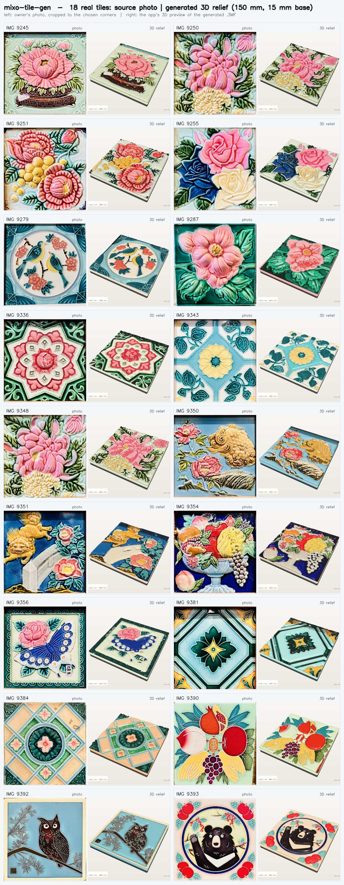

# mixo-tile-gen · 花磚 3D relief generator

Turn a phone photo of a traditional Taiwanese majolica tile (花磚) into a watertight, multi-colour 3D relief (`.3MF`, plus `.GLB`, `.STL` and `.OBJ`, even one wearing your photo as a texture) ready for multi-material 3D printing.

**Live app:** https://mixocreative.github.io/mixo-tile-gen/
**Engine:** Python, running on Google Cloud Run (with a hard spending cap). You can also run the whole app on your own computer with one double-click, phone included; see the [step-by-step guide](#set-it-up-yourself-step-by-step-guide-no-experience-needed).



---

## Why you'll love it

**Point your phone at a tile. Get a 3D-printable copy in about 10–20 seconds** (the first tile after a quiet spell takes up to a minute). There's nothing to install, no account, and it's free.

- **📸 Snap it, done.** Take a photo of any tile: in a museum, on an old house, at a flea market. Crooked angles are fine; the app straightens them for you.
- **🤖 It finds the tile for you.** Google's on-device AI outlines the tile in your browser, and your photo never leaves your phone for that step. You can nudge the four corners with your finger if you want it perfect.
- **🎨 It understands colours.** It works out the glaze colours by itself: up to 8 by default, or pick your own with a tap. Shadows and shine on the glaze don't fool it into inventing extra colours.
- **🏺 It looks like real ceramic, not a stack of pancakes.** Every colour swells gently like glaze, and the edges roll softly down into the seams, the way a real pressed tile does. The thin raised outlines that make 花磚 special are found and rebuilt as smooth ridges.
- **🧩 Ready to print in colour.** Each colour is its own piece, cut to fit its neighbours exactly like a jigsaw, so you can print it in several colours in one go. Want a tiny gap so the pieces snap together? Set the **clearance**.
- **👀 See it before you print.** Spin, zoom and inspect a live 3D preview right in the browser while the file finishes. Flip it between **Colours** (one glaze colour per part, as it will print) and **Photo** (your actual photo wrapped onto the relief), then download the `.3MF`, or `.GLB`, `.STL` or `.OBJ`. The **photo-textured `.OBJ`** wraps your actual photo onto the relief, so it looks like the real tile in Blender, games or AR.
- **⏱️ Fast and honest.** A real progress bar shows what's actually happening ("Carving colour 3 of 8…"), with time left. It's usually about 10–20 seconds.
- **🛠️ Make it yours.** Every setting is a simple number in millimetres. Go big (a 30 cm wall plaque) or tiny (a 5 cm fridge magnet; small tiles automatically get bolder relief so detail survives printing). Change the base thickness, how high the colours rise, how round the edges are, how strong the outlines are, the gaps between pieces, the colour count, the mesh smoothness and more.
- **📱 Works on your phone.** It's designed for phones first: big enough to tap, small enough to stay out of the way.
- **🆓 Free and open.** The website runs on GitHub Pages and the engine on Google Cloud Run's free allowance, or entirely on your own computer for free. Want your own copy? Follow the [step-by-step guide](#set-it-up-yourself-step-by-step-guide-no-experience-needed); no coding needed.

**Fun ideas:** coasters 🍵 · fridge magnets 🧲 · a wall of your neighbourhood's tiles 🏘️ · gifts from a trip to Taiwan 🎁 · restoring a missing tile in an old floor 🔧 · class projects about Taiwanese heritage 🏫

## What it does

1. **Capture.** On a phone: **Take photo** or **Upload** (camera roll / files). On a computer: **Upload**, **drag and drop** the photo onto the page, or **paste** it (Ctrl+V). No photo handy? **Try a sample** loads one of the real test tiles. The photo is never stored.
2. **Outline.** On-device AI (Google AI Edge / MediaPipe Interactive Segmenter) suggests the tile's four corners.
   - Drag the white corner handles to fine-tune; a magnifier appears while you drag. A manual edit always wins over the AI.
   - Or switch to **Square crop** (Cropper.js).
   - The **AI pill** at the top shows *AI: on / loading / off*. If the AI can't load (old phone, blocked network, offline), the app says **AI off · manual** and you simply drag the 4 corners yourself; everything else works the same. The 3D engine itself uses no AI.
3. **Colours.** Tap glaze colours on the flattened tile with the eyedropper, or leave it on **auto**, which picks 3–8 colours.
4. **Size.** Set the tile size and relief settings. The defaults are tuned for a realistic 150 mm tile.
5. **Generate.** Click **Generate 3D relief**. A real progress bar shows the server's actual stages. The 3D preview opens as soon as the shape is ready, while the printable file finishes.
6. **Download** a `.3MF` with **Download .3MF**. At the default 150 mm it's about 10–35 MB, depending on how detailed the tile is. It's one object with one named part per colour, each pre-assigned its own extruder; it opens in PrusaSlicer, OrcaSlicer and Bambu Studio. **Other formats** (the **Other formats…** menu next to the button; each takes about 10–20 s more):

   Every format comes in two looks: **glaze colours** (one flat colour per part, exactly what prints) or **photo texture** (your photo projected straight down onto the relief, lined up exactly; the backing pad keeps a plain colour because its sides would show streaks). The 3D preview has the same **Colours | Photo** switch.

   | Format | Glaze colours | Photo texture | Use it for |
   |---|---|---|---|
   | `.3MF` | ✓ (the main download) | ✓ `.textured.3mf`: viewers show the photo, slicers still print it in glaze colours | 3D printing |
   | `.GLB` | ✓ | ✓ `.textured.glb` | Web viewers, AR, quick sharing |
   | `.OBJ` (zip) | ✓ OBJ + MTL, one object per colour | ✓ OBJ + MTL + `texture.jpg` | Blender, CAD, rendering, games |
   | `.STL` (zip) | ✓ one STL per colour, all lined up | (STL can't hold colour or texture) | Any slicer: load them together, one filament each |

   STEP isn't offered: it's a format for exact CAD surfaces, and a relief of about a million triangles turns into a huge STEP that CAD programs choke on. Import the STL or OBJ instead.

## How the relief is built (design decisions)

These rules came out of many review rounds with the owner. Keep them unless the owner changes them.

| Rule | Why |
|---|---|
| **Every colour is equal.** There is no "background" colour and no height tiers by colour. | A photo doesn't tell you which colour is the ground. |
| **Carve the edges.** Every colour starts at the shared full height; the surface then rolls down smoothly into a soft V-valley at each seam. | On a real tile, glaze fields sit level and only the edges round off. Two neighbouring rectangles give a lowercase **"m"** in cross-section. |
| **Big areas are near-level**, with a gentle crown that flattens as the area grows. Thin strokes stay lower and round. | Looks like pressed, glazed ceramic. |
| **Raised outlines (tube-lining).** Thin light or dark lines are found on the photo itself and become a smooth 0.8 mm ridge. | They are the signature of majolica tiles and are often almost the same colour as their neighbour. |
| **Puzzle-piece borders.** All colours are cut from one shared partition, so neighbours meet exactly with no gap and no overlap. An optional **clearance** leaves a slot between pieces. | Clean multi-material prints; print pieces separately if you like. |
| **Watertight bodies.** Every part is a closed, manifold mesh, checked on every change. | Slicers need it. |

Pipeline (`backend/tile_processor.py`):

```
photo ─► perspective warp (4 corners, 1.5 % inset) ─► colours: bilateral + mean-shift,
k-means (12) in L-weighted Lab, merge shading bands, auto-k (≤ 8) ─► clean-up: majority filter,
speck removal (keeps long thin strokes and high-contrast details), highlight absorb
─► outline detection (morphological top/black-hat on L, skeleton, ridge distance)
─► shared partition φᵢ = (dᵢ − min over other colours dⱼ)/2 ─► per colour: screened-Poisson seam distance →
"carve the edges" height field + outline ridge ─► marching cubes ─► manifold-checked decimation
─► backing pad (rounded slab) ─► .3MF (PrusaSlicer-family part table) / .GLB
```

### Default settings (150 mm tile)

"Label in the app" is the text you see on the page (the ones marked *Advanced* sit under the **Advanced** fold in step 04). "Name for --set / API" is the name to use with `mixo --set name=value` and in the [API](#api).

| Setting | Label in the app | Name for --set / API | Default | Meaning |
|---|---|---|---|---|
| Tile width | Tile width | `tile_size_mm` | 150 mm | Historic 6-inch majolica size. Changing it re-tunes the relief settings below in proportion. |
| Max relief height | Max relief | (app only) | width ÷ 10 | The relief above the base never exceeds this. It is a cap, not a target. |
| Backing pad | Base | `pad_thickness_mm` | 15 mm | Solid base slab. |
| Edge depth | Edge depth | `relief_height_mm` | 3.0 mm | How far each colour rolls down into its seams. |
| Edge roll width | Edge roll | `fillet_radius_mm` | 6.0 mm | Seam to full height. Wider gives a softer valley. |
| Top crown | Crown | `dome_height_mm` | 1.0 mm | Gentle dome; leveler on bigger areas. |
| Groove floor | Groove floor (*Advanced*) | `groove_floor_mm` | 0.4 mm | Material under the seams (2 print layers). |
| Raised outlines | Outlines | `outline_height_mm` | 0.8 mm | Height of the raised line ridge. 0 turns it off. |
| Outline width | Outline width (*Advanced*) | `outline_width_mm` | 1.2 mm | Full width of that ridge. |
| Clearance between colours | Clearance | `clearance_mm` | 0 mm | 0 is a flush fit; e.g. 0.3 leaves slots. |
| Max colours | Max colours | `num_colors` | 8 | Auto picks 3 up to this. |
| Mesh smoothness | Mesh grid (*Advanced*) | `mesh_resolution_mm` | 0.16 mm | Finer than this needs much more memory per tile, so the server enforces it. |
| Smoothing | Smoothing (*Advanced*) | `smoothing_mm` | 1.2 mm | How much the colour regions are tidied. 0 keeps every speck of detail. |
| Colour detail | Detail (*Advanced*) | `px_per_mm` | 4 px/mm | Resolution of the colour analysis. |
| Smallest speck | Min speck (*Advanced*) | `min_feature_mm2` | 2 mm² | Islands and holes smaller than this are dropped. |
| Tile corner radius | Corner radius (*Advanced*) | `corner_radius_mm` | 2.0 mm | Rounding of the tile's four corners, seen from above. |
| Merge shades | Merge shades (*Advanced*) | `merge_delta_e` | 12 | Shading bands of one glaze closer than this are merged. 0 = off. |
| Thin-line minimum | Thin-line min (*Advanced*) | `bead_height_mm` | 1.2 mm | Printable minimum height for thin strokes. |
| Symmetry | Symmetry (*Advanced*) | `symmetry` | `off` | `off`, `auto`, `d4` (8-fold) or `c4` (4-fold). |
| Groove along edge | Groove along edge (*Advanced*) | `edge_is_seam` | off | `true` also cuts a groove along the tile's outer edge. |

A few more settings have no box in the app (`dome_reach_mm` 12, `bead_width_mm` 0.8, `min_band_mm` 3, `remove_glare` off). `mixo --set` accepts them when it runs on your computer. If you type a name it doesn't know, `mixo` prints the full list of valid names.

A 150 mm tile is about 19–20 mm tall (15 mm base plus about 4–5 mm relief) and about 0.9–1.6 M triangles.

## Performance

Measured on the owner's test photos (3024 × 3024):

| Where the engine runs | Time per tile | Notes |
|---|---|---|
| A recent desktop PC (Option A, local) | about 10–12 s | |
| Google Cloud Run, 4 vCPU / 4 GiB (the live site) | about 17–19 s of engine time, about 30 s in the app including transfer | Google's virtual CPUs are slower than a desktop's. With 2 vCPU it was about 25 s, and 2 GiB ran out of memory on a second tile in a row. |

- Peak memory is about 1.5–2 GB per tile. After each tile the engine hands freed memory back to the system, so tile after tile stays within the limit.
- The 3D preview appears before the printable file is finished, and the page never freezes for more than about 1 s.
- **Cold start:** the cloud engine sleeps when idle, so the first tile after a quiet spell adds roughly 20–60 s. The app wakes it as soon as a photo is loaded, and the progress bar says so if it's still waking.

## Set it up yourself: step-by-step guide (no experience needed)

> **Just want to use it?** Open https://mixocreative.github.io/mixo-tile-gen/. It's already connected to an engine, so skip this whole section.

The app has two halves:

| Half | What it is | Where it can run |
|---|---|---|
| **Website** (front end) | The page you see in the browser. | GitHub Pages (free), or your own computer |
| **Engine** (back end, Python) | Turns the photo into the 3D file. | **Your own computer** (free), or **Google Cloud Run** (online all the time) |

### Which way should I use?

Every way has the same features: all download formats, glaze colours or photo texture. The AI only suggests the tile's corners; without it you drag the four corners yourself.

| I want to... | Use | Needs | Go to |
|---|---|---|---|
| Use it online, nothing to install | The live website | A browser | [Live app](https://mixocreative.github.io/mixo-tile-gen/) |
| Use it online **without the web page** (scripts, batches) | `mixo photo.jpg --server <engine address>`, or `curl` | Python (for `mixo`) | [Command line](#without-the-web-page-command-line) |
| Run it on my computer **with the web page** | `start-windows.bat` or `bash start-mac-linux.sh` | Python, internet (the page loads some libraries from the internet) | [Option A](#option-a-run-everything-on-your-own-computer-free) |
| Run it on my computer **without the web page** | `mixo photo.jpg` | Python. Fully offline after the first setup | [Command line](#without-the-web-page-command-line) |
| Use it on my phone, through my computer | `start-windows-phone.bat` or `bash start-mac-linux.sh phone`, then scan a QR code (same Wi-Fi, or the Cloudflare link) | Option A | [Option A, step 4](#option-a-run-everything-on-your-own-computer-free) |
| Have the AI find the corners | The web page, with internet | A browser | [What it does](#what-it-does) |
| Skip the AI and place the corners myself | The web page when it says **AI off · manual**, or `mixo --corners` | Nothing extra | [What it does](#what-it-does), [Command line](#without-the-web-page-command-line) |
| Have my own engine that is online all the time | Google Cloud Run, with a spending cap | A Google account and a card | [Option B](#option-b-google-cloud-run-online-all-the-time-with-a-hard-spending-cap) |
| Have my own copy of the website | Fork on GitHub, GitHub Pages | A free GitHub account | [Option D](#option-d-your-own-copy-of-the-website-github-pages) |
| Run the engine in Docker | `docker build` and `docker run` | Docker Desktop | [Option C](#option-c-docker-for-tinkerers) |

Pick where the engine runs:

| | Cost | Works when your computer is off? | Phone? | Difficulty |
|---|---|---|---|---|
| **[A. Your own computer](#option-a-run-everything-on-your-own-computer-free)** | Free | No | Yes, same Wi-Fi or a free Cloudflare link | Easiest: double-click a file |
| **[B. Google Cloud Run](#option-b-google-cloud-run-online-all-the-time-with-a-hard-spending-cap)** | About $0, card required, hard cap | Yes | Yes | Copy and paste 6 blocks |
| **[C. Docker](#option-c-docker-for-tinkerers)** | Free | No | Yes | Needs Docker |

> **What about Hugging Face?** As of 2026, Hugging Face only runs this kind of engine (a "Docker Space") for paying PRO accounts. If you have PRO, see [the note at the end](#hugging-face-pro-accounts-only).

---

### Basics: Python and the terminal

You need these for Option A, the command line and (a little) Option C.

**Python (one time).** You need **version 3.11 or newer; 3.13 is recommended.** This is the same on Windows, Mac and Linux. Check with `python --version` (Windows) or `python3 --version` (Mac/Linux).

- **Windows:** go to https://www.python.org/downloads/ and click the big yellow **Download Python** button. Run the installer, tick **"Add python.exe to PATH"** at the bottom of the first screen, then click **Install Now**.
  - *Typing `python` opens the Microsoft Store?* Windows has a fake `python` shortcut. Turn it off: **Settings → Apps → Advanced app settings → App execution aliases**, switch **off** `python.exe` and `python3.exe`. Then install Python from python.org (not from the Store) and open a new terminal.
- **Mac:** same page; open the downloaded `.pkg` and click through. Then open **Applications → Python 3.13** (the folder the installer made) and double-click **Install Certificates.command** once. Without it, the phone tunnel download and `--server` fail with a certificate error.
- **Linux:** usually already installed. On Debian/Ubuntu also run `sudo apt install python3-venv python3-pip`. Other distros: install the same two things with your package manager.

**Open a terminal in the app folder.** A terminal is the window where you type commands. It must be "in" the app folder (the one that contains `README.md`, `backend` and `start-windows.bat`).

- **Windows:** open the app folder in File Explorer, click the address bar at the top, type `cmd` and press **Enter**. A black window opens in that folder. (In PowerShell or Windows Terminal, type `.\mixo.bat` instead of `mixo`, or type `cmd` first.)
- **Mac:** press **Cmd + Space**, type `Terminal`, press Enter. Type `cd ` (with a space after it), drag the app folder from Finder into the Terminal window, and press Enter.
- **Linux:** right-click the app folder → **Open in Terminal**.

**Mac and Linux commands.** A ZIP download loses the "executable" mark on files, so `./start-mac-linux.sh` may say *Permission denied*. Start the scripts with `bash` instead: `bash start-mac-linux.sh`, `bash start-mac-linux.sh phone`, `bash mixo.sh ...`. (Alternatively, run `chmod +x start-mac-linux.sh mixo.sh` once, after which `./start-mac-linux.sh` works.)

**Paths with spaces** need quotes: `mixo "C:\My Photos\tile 1.jpg"`.

---

### Option A: run everything on your own computer (free)

Website and engine both run on your computer. Nothing to sign up for.

**1. Install Python (one time).** See [Basics](#basics-python-and-the-terminal).

**2. Download the app.**
1. On https://github.com/mixocreative/mixo-tile-gen click the green **Code** button, then **Download ZIP**.
2. Find the ZIP (usually in your **Downloads** folder). **Right-click it → Extract All** (Mac/Linux: double-click it). Don't run files from inside the ZIP; that fails.
3. Open the extracted folder, and keep opening folders until you see **`start-windows.bat`**, **`README.md`** and **`backend`** together. That is the app folder. Move it somewhere easy, like your Desktop.

**3. Start it.**
- **Windows:** in the app folder, double-click **`start-windows.bat`**.
  - If a blue "Windows protected your PC" box appears, click **More info → Run anyway**. It's a plain text script you can open in Notepad to check.
- **Mac / Linux:** open a terminal in the app folder (see [Basics](#basics-python-and-the-terminal)) and run:
  ```bash
  bash start-mac-linux.sh
  ```

The **first start takes 3–10 minutes** because it downloads the engine's parts (about 400 MB). **It can look frozen, with no new text for several minutes. That is normal. Wait.** Later starts take about 10 seconds. When you see

```
[mixo] READY  ->  open http://localhost:8088/?api=self
```

your browser opens the app by itself. **Keep the black window open** while you use the app; closing it (or pressing **Ctrl + C**) stops everything.

**After you press Generate.**
- The file goes to your browser's normal **Downloads** folder.
- Open it in **PrusaSlicer, OrcaSlicer or Bambu Studio**. Each colour is a separate part. Give each part its own filament (extruder), then slice and print. The `.3MF` already has one extruder per part, so you only pick the filament colours.

**4. Use it on your phone (optional).**
- **Windows:** double-click **`start-windows-phone.bat`** instead.
- **Mac / Linux:** run `bash start-mac-linux.sh phone`.

A page with **QR codes** opens. Scan one with your phone's camera:

| QR code | When to use it | Notes |
|---|---|---|
| **Same Wi-Fi** | Phone and computer on the same Wi-Fi | Fastest. If it doesn't load, see the troubleshooting table below. |
| **Anywhere (Cloudflare link)** | Phone on mobile data, or a friend elsewhere | Free [Cloudflare quick tunnel](https://developers.cloudflare.com/cloudflare-one/connections/connect-networks/do-more-with-tunnels/trycloudflare/). No account needed. The tool downloads itself the first time. |

> 🔒 The Cloudflare link works for **anyone who has it** while the window is open. It's a long random address that changes every time you start, and it stops working when you close the window. Only share it with people you trust.

**Next time, restart, update, uninstall**

| I want to... | Do this |
|---|---|
| Use it again later | Double-click `start-windows.bat` again (Mac/Linux: `bash start-mac-linux.sh`). It starts in about 10 seconds. |
| Restart it | Close the black window (or Ctrl + C), then start it again. |
| Fix "Engine: unreachable" | You closed the black window, so the engine stopped. Start it again and reload the page. |
| Update to a newer version | Download a new ZIP and extract it to a new folder. To skip the 400 MB download, you can copy the old `.venv` folder into the new app folder. If it then misbehaves, delete that `.venv` and start again. |
| Uninstall | Delete the app folder. Nothing else was installed except Python. |

**Troubleshooting (Option A)**

| Problem | What to do |
|---|---|
| **"Python is not installed"** but you did install it | Restart the computer, or re-run the installer and tick "Add python.exe to PATH". On Windows also check the Microsoft Store alias note in [Basics](#basics-python-and-the-terminal). |
| **Windows asks "Allow Python on networks?"** | Tick **Private networks** and click **Allow**. The same-Wi-Fi QR code needs this. |
| **"Using port 36189 (8088 was busy)"** (any number) | Fine: something else uses 8088, so the app keeps trying random free ports until one works. The READY line, the browser tab and the QR page all use the port it picked. |
| **Install failed halfway** (internet dropped) | Delete the `.venv` folder inside the app folder and start again. |
| **Antivirus blocks `tools\cloudflared.exe`** (phone link) | Allow that file in your antivirus, or use the same-Wi-Fi QR code instead. |
| **Same-Wi-Fi QR doesn't load** | Guest Wi-Fi and some routers stop devices from seeing each other ("AP isolation"). Use the Cloudflare QR instead, or join your normal Wi-Fi. |
| **Cloudflare QR doesn't load** | Some office and school networks block Cloudflare. Use the same-Wi-Fi QR, or another network. |
| **Page loads but looks broken** | The page loads its libraries from the internet. Check that the computer is online. |

---

### Option B: Google Cloud Run (online all the time, with a hard spending cap)

The engine runs on Google's servers, so the website works even when your computer is off. Google's free allowance covers roughly **2,000 tiles a month** (each tile uses about 70 vCPU-seconds at 4 vCPU), so **normal use costs $0**. Google changes its free-tier details from time to time; check the current numbers on [Google's Cloud Run pricing page](https://cloud.google.com/run/pricing). Google still requires a card on file, so this guide adds a **kill switch**: if spending ever reaches the cap you choose, billing switches off automatically and nothing more can be charged.

**How to paste.** In Cloud Shell, paste with **Ctrl + Shift + V** (Windows/Linux) or **Cmd + V** (Mac), or right-click → Paste. If a box asks you to confirm a multi-line paste, confirm it. Then press **Enter** if the last line did not run by itself.

> **If Cloud Shell reconnects, or you come back later:** Cloud Shell forgets your settings when it restarts. Before anything else, paste **Block 1** again (and the `BILLING=` line), then run:
> ```bash
> gcloud config set project $PROJECT && cd ~/mixo-tile-gen
> ```
> and continue where you stopped. (Before Block 3 has run, the `cd` part shows an error; ignore it.)

**1. Turn on billing (one time, in the browser).**
1. Open https://console.cloud.google.com/billing.
   > **Several Google accounts?** Google picks the first one. Add `?authuser=you@gmail.com` to the address (for example `https://console.cloud.google.com/billing?authuser=you@gmail.com`), or open a private window (**Ctrl + Shift + N**) and sign in with only the account you want. Check the avatar at the top right.
2. Click **Create account** (or start the **Free trial** if offered; the trial credit is optional and not needed). Choose **Individual**, enter your card, and submit. A small temporary card check may appear; it's refunded.

**2. Open Cloud Shell.** Go to https://console.cloud.google.com (same account), then click the **>_** icon at the top right. A terminal opens at the bottom of the page. Nothing to install.

**3. Paste the blocks below one at a time**, pressing **Enter** after each. Click **Authorize** if asked.

Block 1: settings. **Change the first line** to a name that's yours (lower case, letters, digits and dashes, 6–30 characters, must be unique on Google):
```bash
PROJECT=mixo-tile-gen-yourname
REGION=asia-east1        # Taiwan. Others: us-central1, europe-west1, asia-northeast1 ...
SITE=https://mixocreative.github.io   # the website allowed to use your engine (no path, no trailing /)
gcloud billing accounts list
```
The last command shows a table. Copy the **ACCOUNT_ID** of the account with `OPEN True`, then paste this (with your ID):
```bash
BILLING=000000-000000-000000
```
If Block 2 later says the **project ID already exists**, someone already has that name. Go back, change the name on the first line of Block 1, paste Block 1 and the `BILLING=` line again, then paste Block 2 again.

Block 2: project, billing and services. If you get a permission error, wait a minute and paste it again.
```bash
gcloud projects create $PROJECT && gcloud config set project $PROJECT
gcloud billing projects link $PROJECT --billing-account=$BILLING
gcloud services enable run.googleapis.com cloudbuild.googleapis.com artifactregistry.googleapis.com \
  compute.googleapis.com cloudfunctions.googleapis.com eventarc.googleapis.com pubsub.googleapis.com \
  billingbudgets.googleapis.com cloudbilling.googleapis.com
NUM=$(gcloud projects describe $PROJECT --format='value(projectNumber)')
for r in cloudbuild.builds.builder storage.objectViewer artifactregistry.writer logging.logWriter; do
  gcloud projects add-iam-policy-binding $PROJECT --member=serviceAccount:$NUM-compute@developer.gserviceaccount.com \
    --role=roles/$r --condition=None --quiet >/dev/null; done
echo OK
```

Block 3: the engine. Takes 5–10 minutes. If it says *Permission denied … Artifact Registry* (or any permission error), wait one minute and paste it again; new projects need a moment. Pasting it again is safe.
```bash
[ -d mixo-tile-gen ] || git clone https://github.com/mixocreative/mixo-tile-gen.git
cd ~/mixo-tile-gen
gcloud run deploy mixo-tile-gen --source backend --region $REGION --allow-unauthenticated \
  --cpu 4 --memory 4Gi --concurrency 4 --timeout 300 --min-instances 0 --max-instances 1 \
  --set-env-vars ALLOWED_ORIGINS=$SITE,MIXOTILE_BODY_WORKERS=2 --quiet
```
**Success:** the last lines show `Service URL: https://mixo-tile-gen-….run.app`. **That's your engine address.** Open it with `/health` added; you should see `{"status":"ok", …}`.
**If `/health` fails:** wait a minute and reload. If it still fails, open https://console.cloud.google.com/run, click **mixo-tile-gen**, then the **Logs** tab, and read the last red lines.

Block 4: the kill switch (a tiny function that switches billing off). If you get a permission error, wait a minute and paste it again.
```bash
cd ~/mixo-tile-gen
gcloud pubsub topics create budget-alerts
gcloud iam service-accounts create budget-killswitch --display-name=budget-killswitch
KS=budget-killswitch@$PROJECT.iam.gserviceaccount.com
gcloud projects add-iam-policy-binding $PROJECT --member=serviceAccount:$KS --role=roles/billing.projectManager --condition=None --quiet >/dev/null
gcloud projects add-iam-policy-binding $PROJECT --member=serviceAccount:$KS --role=roles/browser --condition=None --quiet >/dev/null
gcloud functions deploy budget-killswitch --gen2 --runtime python312 --region $REGION \
  --source ops/budget_killswitch --entry-point stop_billing --trigger-topic budget-alerts \
  --service-account $KS --set-env-vars TARGET_PROJECT=$PROJECT --memory 256Mi --max-instances 1 --quiet
gcloud run services add-iam-policy-binding budget-killswitch --region $REGION \
  --member=serviceAccount:$KS --role=roles/run.invoker >/dev/null && echo OK
```

Block 5: the budget (the cap). Use your billing account's currency, shown by `gcloud billing accounts describe $BILLING`: for example `30TWD`, `1USD` or `1EUR`.
```bash
gcloud billing budgets create --billing-account=$BILLING --display-name=mixo-tile-gen-cap \
  --budget-amount=1USD --filter-projects=projects/$PROJECT \
  --threshold-rule=percent=0.5 --threshold-rule=percent=0.9 --threshold-rule=percent=1.0 \
  --notifications-rule-pubsub-topic=projects/$PROJECT/topics/budget-alerts
```
You also get an **email** at 50 % and 90 % of the cap.

Block 6 (optional, recommended): test the kill switch. This pretends the cap was reached, checks that billing went off, then switches it back on:
```bash
gcloud pubsub topics publish budget-alerts --message='{"costAmount": 2, "budgetAmount": 1, "currencyCode": "USD"}'
sleep 60; gcloud billing projects describe $PROJECT --format='value(billingEnabled)'   # should print False
gcloud billing projects link $PROJECT --billing-account=$BILLING >/dev/null; echo "billing back on"
```
- **It printed `False`:** the kill switch works. 
- **It printed `True`:** the function may still be starting. Wait a minute and run only the `describe` line again. If it still says `True`, read the function's log: `gcloud functions logs read budget-killswitch --region $REGION --gen2`.
- **Do not skip the last line** (`gcloud billing projects link …`), even if the test failed or you stopped halfway. Until you run it, billing stays off and your engine stays stopped.

**4. Connect the website** to your engine address. See [Connect the website to your engine](#connect-the-website-to-your-engine).

**Good to know**
- **When nobody uses it,** the engine sleeps and costs nothing. The first tile after a quiet spell takes 20–60 s longer while it wakes up; the progress bar says so.
- **If the cap is ever reached,** the engine stops working (the site shows "Engine: unreachable"). To turn it back on, link the project to your billing account again. In Cloud Shell (paste Block 1 and the `BILLING=` line first if it restarted), run:
  ```bash
  gcloud billing projects link $PROJECT --billing-account=$BILLING
  ```
  or open Billing → **My projects** in the browser and link it there. Google's cost reports lag a few hours, so the final bill can be a few cents above the cap. Allowing only one engine copy at a time (`--max-instances 1`) keeps that small.
- **Update to a newer version.** In Cloud Shell (after pasting Block 1 and `gcloud config set project $PROJECT`):
  ```bash
  cd ~/mixo-tile-gen && git pull
  ```
  then paste the `gcloud run deploy …` command from Block 3 again.
- **To remove everything.** Run `gcloud projects delete $PROJECT`, or go to https://console.cloud.google.com/cloud-resource-manager, select the project and click **Delete**. The budget belongs to your billing account, not the project, so also open Billing → **Budgets & alerts** and delete `mixo-tile-gen-cap`.

---

### Option C: Docker (for tinkerers)

Install **Docker Desktop** (https://www.docker.com/products/docker-desktop/) and start it. Give it at least **4 GB of memory**: Docker Desktop → **Settings → Resources**. Then open a terminal in the unzipped app folder (see [Basics](#basics-python-and-the-terminal)) and run:

```bash
docker build -t mixo-tile-gen backend
```

Then start it. Pick the line for your terminal:

```bash
# Mac, Linux, Git Bash
docker run --rm -p 8088:8080 -v "$PWD/frontend:/frontend" -e FRONTEND_DIR=/frontend mixo-tile-gen
```
```bat
:: Windows Command Prompt (cmd)
docker run --rm -p 8088:8080 -v "%cd%\frontend:/frontend" -e FRONTEND_DIR=/frontend mixo-tile-gen
```
```powershell
# Windows PowerShell
docker run --rm -p 8088:8080 -v "${PWD}/frontend:/frontend" -e FRONTEND_DIR=/frontend mixo-tile-gen
```

Open **http://localhost:8088/?api=self**. Press **Ctrl + C** in the terminal to stop it. Without the `-v … -e …` part you get the engine only, with no website.

---

### Connect the website to your engine

The website needs to know the engine's address. Choose one:

| How | Steps | Best for |
|---|---|---|
| **The Engine pill** | On the website, click the pill at the **top right** ("Engine: …"). Paste your engine address (no `/health` on the end), then **Save & test**. The dot turns green ("Engine: ready"). Your browser remembers it. | Just you |
| **A link** | Add `?api=` plus the address to the website link, e.g. `https://mixocreative.github.io/mixo-tile-gen/?api=https://mixo-tile-gen-xxxx.asia-east1.run.app` | Sharing with friends |
| **The default** (your own copy) | On github.com, in your fork: open `frontend/index.html`, click the **pencil** icon (Edit this file), find the line `const DEFAULT_API = '…';` and put your address between the quotes. Click **Commit changes…**, then **Commit changes** in the box. Wait about a minute for the site to update. | Everyone who visits your copy |

`?api=self` means "the engine is at this same address". Option A's links use it, because there the engine also serves the website.

**Self-hosting everything?**
- **Option A or C:** the website comes with the engine; nothing to connect.
- **Your own GitHub Pages site + your own Cloud Run engine:** deploy the engine with `SITE=https://YOUR-GITHUB-NAME.github.io` (Option B, block 1), then set `DEFAULT_API` in your copy.
- **Website already deployed and only the allowed site needs changing:** run `gcloud run services update mixo-tile-gen --region $REGION --update-env-vars ALLOWED_ORIGINS=https://YOUR-GITHUB-NAME.github.io`.

**If the dot is red ("unreachable"):**
- Open the engine address with `/health` on the end. If that fails, the engine is off or asleep (or its spending cap was reached).
- The engine's `ALLOWED_ORIGINS` must exactly match your website's address: `https://NAME.github.io`, with no path and no trailing `/`.
- A sleeping engine takes 20–60 s to wake. Try again.

---

### Option D: your own copy of the website (GitHub Pages)

1. Create a free account at https://github.com/signup.
2. Open https://github.com/mixocreative/mixo-tile-gen and click **Fork**, then **Create fork**. Keep the repository name `mixo-tile-gen`, so your site address ends in `/mixo-tile-gen/`.
3. In your fork, go to **Settings → Pages**. Under **Build and deployment → Source**, choose **GitHub Actions**.
4. Go to the **Actions** tab. A fresh fork has workflows switched off: click the green **I understand my workflows, go ahead and enable them** button first.
5. Still in **Actions**, click **Deploy frontend to GitHub Pages**, then **Run workflow**.
6. After about a minute your website is at `https://YOUR-GITHUB-NAME.github.io/mixo-tile-gen/`.
7. Connect it to your engine (previous section). Until you do, your copy shows **"Engine: unreachable"**. That is expected: it still points at the original engine, which only answers the original website.

---

### Hugging Face (PRO accounts only)

Free accounts get `402 Payment Required` when creating a Docker Space. With **PRO**:
1. Create a Space at https://huggingface.co/new-space: SDK **Docker → Blank**, **Public**.
2. Upload `backend/Dockerfile`, `main.py`, `tile_processor.py` and `requirements.txt`.
3. Add `sdk: docker` and `app_port: 8080` to the front matter of the Space's `README.md`.
4. Add the variable `ALLOWED_ORIGINS` = your website (Settings → Variables and secrets).
5. Your engine address is `https://YOUR-HF-NAME-SPACE-NAME.hf.space`.

### Without the web page (command line)

`mixo` makes the same models from the command line: one photo, or a whole folder at once. The files are the same as the website's. It uses no AI, so you give it the tile's corners.

**1. Install Python** and **download the app** (Option A, steps 1 and 2). See [Basics](#basics-python-and-the-terminal).

**2. Open a terminal in the app folder** (see [Basics](#basics-python-and-the-terminal)). On Mac/Linux, write `bash mixo.sh` instead of `mixo`. In PowerShell, write `.\mixo.bat`.

**3. Try it now, with the bundled photo.** This uses one of the owner's photos that comes in the download. `--out` puts the result in the app folder:

```bash
mixo backend\tests\fixtures\real_tiles\originals\IMG_9255.jpg --corners "510,564 2616,534 2514,2508 594,2478" --out my-first-tile.3mf
```
On Mac/Linux:
```bash
bash mixo.sh backend/tests/fixtures/real_tiles/originals/IMG_9255.jpg --corners "510,564 2616,534 2514,2508 594,2478" --out my-first-tile.3mf
```

The first run sets itself up (3–10 minutes, same as Option A; it may look frozen). After that, a tile takes about 10–12 s. You will see something like this (your numbers will differ):
```
IMG_9255.jpg -> my-first-tile.3mf  (this computer)
   45%  Carving colour 3 of 8
  100%  done: 9 colour bodies, 1,234,567 triangles
  saved 32.9 MB in 12.5 s
```
Open `my-first-tile.3mf` in PrusaSlicer, OrcaSlicer or Bambu Studio.

**4. Use your own photo.** Without `--out`, the file lands next to the photo (`my-tile.3mf`).
```bash
mixo my-tile.jpg --corners "510,564 2616,534 2514,2508 594,2478"
```
If you leave out `--corners`, `mixo` prints this warning and uses the centred square of the photo:
```
! my-tile.jpg: no corners given, using the centred square of the photo
```

**Finding your tile's four corners.** They are pixel positions in the **full-size photo** (not a shrunken copy). Go top-left, top-right, bottom-right, bottom-left, on the glaze corners.
- **Windows:** open the photo in Paint and hover over each glaze corner. The position shows at the bottom of the window.
- **Mac:** Preview doesn't show pixel positions easily. Open the full-size photo in the free https://www.photopea.com, hover over each corner and read the **X** and **Y** values in the info panel.
- **Any system:** use the web app. Upload the photo, drag the corners, and note where the handles sit.

**More examples:**
```bash
mixo my-tile.jpg --corners "…" --format 3mftex          # 3MF with the photo as a texture
mixo my-tile.jpg --corners "…" --format objtex --out tile.zip
mixo my-tile.jpg --corners "…" --set tile_size_mm=100 --set pad_thickness_mm=8
mixo a.jpg b.jpg c.jpg --corners-json corners.json --out models   # many photos at once
mixo my-tile.jpg --corners "…" --server https://mixo-tile-gen-616971929665.asia-east1.run.app   # use the online engine
mixo "C:\My Photos\tile 1.jpg" --corners "…"            # quotes around paths with spaces
```
- `--format`: `3mf` (default), `3mftex`, `glb`, `glbtex`, `obj`, `objtex`, `stl`.
- `--corners-json`: a file like `{"a": [[x,y],[x,y],[x,y],[x,y]], "b": …}`, keyed by photo name without `.jpg`.
- `--set`: any setting from [Default settings](#default-settings-150-mm-tile), using the names in the "Name for --set / API" column. An unknown name prints the full list of valid names.
- `--server`: send the photo to an engine instead of using this computer (the online engine above, your own Cloud Run address, or a local one like `http://localhost:8088`).
- Fully offline: after the first setup, `mixo` without `--server` needs no internet.

**Without `mixo`**, any tool that can send a form works, e.g. `curl`. Replace `YOUR-ENGINE` with your engine address.

Windows Command Prompt (`cmd`). Use `curl.exe` and double quotes:
```bat
curl.exe -F image=@my-tile.jpg -F "corners=[[510,564],[2616,534],[2514,2508],[594,2478]]" -F output_format=3mftex -o my-tile.textured.3mf https://YOUR-ENGINE/process-tile
```
Mac, Linux, Git Bash:
```bash
curl -F image=@my-tile.jpg -F 'corners=[[510,564],[2616,534],[2514,2508],[594,2478]]' \
     -F output_format=3mftex -o my-tile.textured.3mf https://YOUR-ENGINE/process-tile
```
(In Windows PowerShell, `curl` is a different command, an alias of `Invoke-WebRequest`. Use `curl.exe`, or use Command Prompt.)

An engine only answers browsers from the websites in its `ALLOWED_ORIGINS`; command-line tools like these aren't affected.

## API

- `GET /health` returns `{"status":"ok", …}`.
- `POST /process-tile` takes `multipart/form-data`:
  - **Required:** `image`.
  - **Optional:** `corners` (JSON `[[x,y]×4]`), `swatches` (JSON hex list), plus any setting above, using the names in `TileConfig`: `tile_size_mm`, `pad_thickness_mm`, `relief_height_mm`, `fillet_radius_mm`, `dome_height_mm`, `groove_floor_mm`, `clearance_mm`, `outline_height_mm`, `outline_width_mm`, `num_colors`, `mesh_resolution_mm`, `smoothing_mm`, `symmetry`, `output_format` (`3mf` | `3mftex` = 3MF with the photo as a texture, still prints in glaze colours | `glb` | `glbtex` | `stl` = zip, one STL per colour | `obj` = zip, OBJ+MTL colours | `objtex` = zip, OBJ+MTL+texture.jpg).
- `stream=false` (default) returns the model bytes, plus stats in the `X-MixoTile-Stats` header.
- `stream=true` returns a single streamed response, used by the app:
  - JSON lines: `{"type":"progress","p":0.42,"msg":"Carving colour 3 of 8"}`.
  - Then `{"type":"preview","layout":[…],"bytes":N}` followed by N bytes of preview mesh (float32 positions and uint32 indices per part).
  - Then `{"type":"texture","bytes":T}` followed by T bytes of JPEG: the top-down photo for the preview's Photo view (u = x/size, v = y/size).
  - Then `{"type":"done","bytes":M}` followed by M bytes of model, or `{"type":"error",…}`.

## Tests and verification

Tests use **only the owner's hand-picked photos**: 18 shots in `backend/tests/fixtures/real_tiles/originals/`, with their tile corners in `real_tiles/corners.json` (see the README there). Every pipeline change must pass on all of them. Start the app (Option A) once first, so the app's own Python environment `.venv` exists, then run from the `backend` folder with that Python:

Windows (Command Prompt):
```bat
cd backend
..\.venv\Scripts\python tests\run_real.py
```
Mac / Linux:
```bash
cd backend
../.venv/bin/python tests/run_real.py
```

The other checks work the same way; swap in the script name:
```
tests/run_real.py                  every photo: each colour body watertight, time per tile
tests/check_formats.py IMG_9255    STL closed per colour, OBJ materials, photo texture lined up
tests/check_borders.py IMG_9255 0  puzzle-fit between colours (gap / overlap)
tests/lines_sheet.py               visual sheet: photo | outlines | colours | height map
```
On a PC with little memory, test one tile per run: `..\.venv\Scripts\python tests\run_real.py IMG_9255`.

`HANDOFF.md` has the full engineering log, the design decisions and the next steps, for whoever picks this up (human, Claude, or Codex). `AGENTS.md` has the rules for coding agents.

## Known limits

- **Auto-outline:** the AI only suggests the corners. On framed tiles it sometimes grabs a sliver of the wooden frame (seen on IMG_9255 and IMG_9343 in the tests). Always check the four corners and drag any that are off.
- **Low-contrast tiles:** a white motif on a pale background can merge into one colour. Picking the colours yourself with the eyedropper may keep them apart.
- **Glossy, painterly glazes** can still split into small patches.
- **Stickers or labels** on the glaze become relief. The glare/sticker inpaint is implemented but off by default, because it also erased real white glaze.

## Credits

- **Tile photos** (tests, results table and the in-app sample): taken and hand-picked by the owner.
- **Built with:** FastAPI, OpenCV, scikit-image, scikit-learn, SciPy, fast-simplification, trimesh; Three.js, MediaPipe Tasks Vision, Cropper.js and Tailwind (via CDN).
