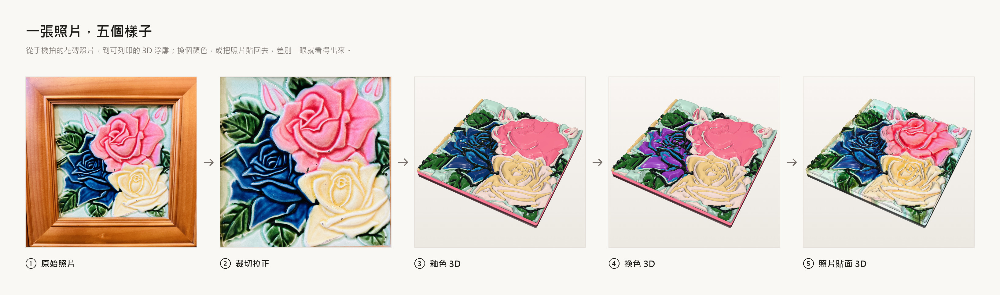
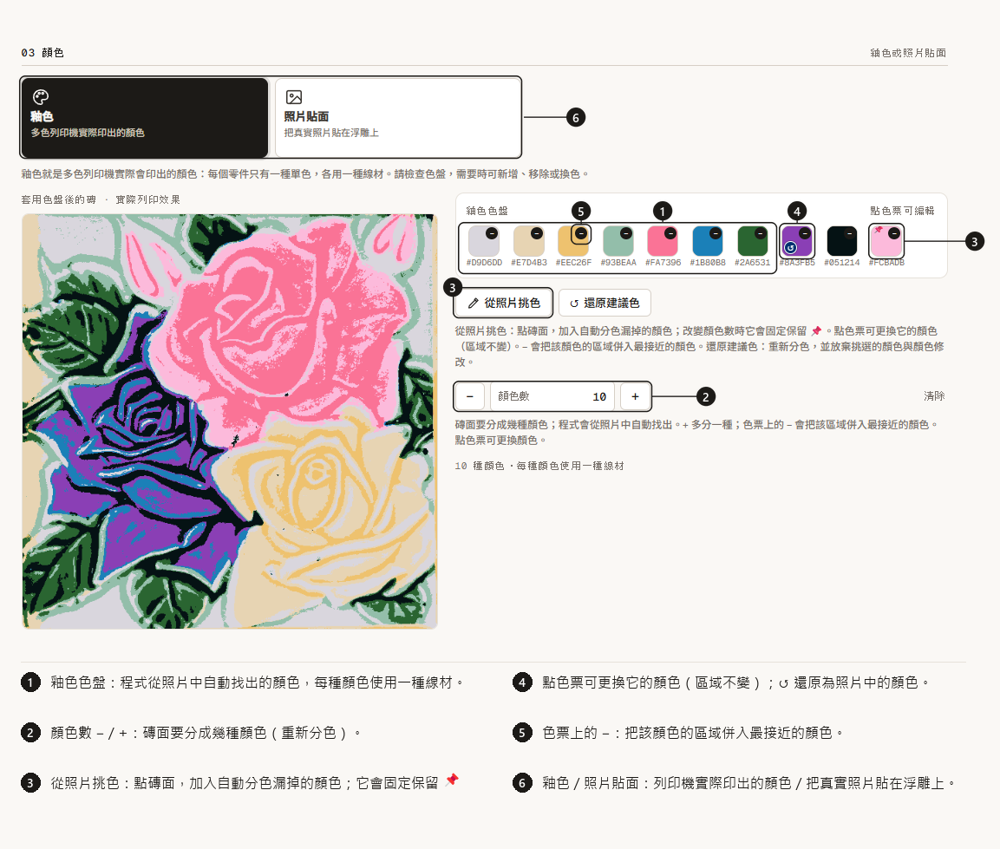
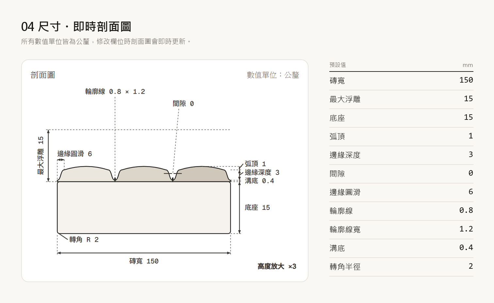

**繁體中文** | [English](README.en.md)

# mixo-tile-gen · 花磚 3D 浮雕產生器

把一張台灣傳統花磚（馬約利卡釉面磚）的手機照片，變成封閉無破洞（watertight）的多色 3D 浮雕（`.3MF`，另有 `.GLB`、`.STL` 和 `.OBJ`，甚至可以直接把你的照片貼在模型上當貼圖），直接拿去做多材料 3D 列印。

**線上版：** https://mixocreative.github.io/mixo-tile-gen/
**引擎：** Python，跑在 Google Cloud Run 上（設有硬性花費上限）。你也可以只要雙擊一下，就在自己的電腦上執行整個應用程式，連手機也能一起用；請見[逐步指南](#自己架設逐步指南零基礎也能上手)。



---

## 為什麼你會愛上它

**手機對準花磚，約 20 秒就能拿到可 3D 列印的複製品**（閒置一陣子後的第一塊磚最久可能要一分鐘）。不用安裝、不用註冊帳號，而且免費。支援 **English** 和 **繁體中文**，會依手機語言自動切換（第一頁也能手動切換）。

- **📸 拍下來就完成。** 博物館裡、老房子牆上、跳蚤市場，任何一塊花磚都能拍。角度歪了也沒關係，App 會幫你拉正。你的照片只在記憶體中處理，不會被保存。
- **🤖 它幫你找出花磚，但決定權還是在你。** Google 的裝置端 AI 會直接在你的瀏覽器裡建議四個角的位置。你一定可以自己檢查、拖到準確的位置，還有放大鏡輔助。如果 AI 載入不了，App 會顯示 **AI：關閉・手動**，其他功能完全照常運作。
- **🎨 顏色自動幫你分好。** 用 **− / +** 告訴它想要幾種顏色，它就替你把花磚分色。漏掉某個顏色？按 **從照片挑色**（Pick from photo）就能補上（還會固定保留 📌）。點任何一個色票就能換成別的顏色，也可以把兩種顏色合併成一種。
- **🖼️ 釉色或照片貼面，一鍵切換。** 一個大開關決定你看到的樣子。**釉色**（Glaze colours）是單一平塗的顏色，也就是多色列印機實際會印出的顏色。**照片貼面**（Photo skin）則把你的真實照片貼在浮雕上，看起來就像真的花磚（列印機仍然印釉色）。
- **🏺 看起來像真的陶瓷，不是一疊鬆餅。** 每種顏色都像釉料一樣微微隆起，邊緣在接縫處柔和地滑進淺淺的谷底，就像真正壓製出來的磚。花磚最迷人的那些細細凸起輪廓線，也會被找出來，重建成圓滑的稜線。
- **🧩 直接就能多色列印。** 每種顏色都是獨立的零件，彼此像拼圖一樣精準嵌合。每個零件都是水密閉合的。想留一點點縫隙讓零件能卡進去？調整**間隙**（clearance）即可。
- **👀 先預覽，再即時微調。** 在瀏覽器裡旋轉、縮放 3D 預覽，有大大的 **釉色 / 照片** 切換，以及 **俯視** 和 **斜視** 兩種視角。預覽會比其他東西更早打開。接著拖曳 **微調（即時）** 的滑桿（底座厚度、邊緣深度、弧頂、溝底、輪廓線高度），邊拖邊看模型跟著動，手機上也一樣。按 **套用** 就能在瀏覽器裡立刻更新完整模型，不必等雲端。
- **📦 檔案在你的裝置上製作。** 雲端只負責建出形狀；等你需要時，由你自己的瀏覽器寫出檔案：**3MF** 用於多色列印（PrusaSlicer、OrcaSlicer、Bambu Studio）、**GLB** 用於網頁檢視、AR 與分享、**OBJ** 給 Blender，還有 **STL**（每種顏色一個檔案）。選擇 3MF、GLB 或 OBJ 的 **+ 照片貼面** 版本，模型上就會附上你的照片。
- **🛠️ 照你的想法來調。** 每個設定都是簡單的公釐數值，旁邊有即時剖面圖，會標示出你正在編輯的那一項。每一項都有自己的 ↺ 還原鈕，你的選擇下次來還會記得。想做大的（30 公分壁掛飾板）或小的（5 公分冰箱磁鐵）都行；小尺寸的磚會自動加強浮雕，讓細節在列印後仍然清晰。
- **📱 手機也好用。** 以手機為優先設計：只有一個 **拍照或選擇照片** 按鈕、點擊範圍夠大，下載時也盡量不吃手機記憶體。
- **🆓 免費，而且想怎麼用都行。** 用網站、或雙擊一下就在自己的電腦上執行整個 App（手機可以透過同一個 Wi-Fi，或用免費的 Cloudflare 連結搭配 QR code 加入）、或是不開網頁，直接用 `mixo` 指令處理一張或一整批照片。線上引擎有硬性花費上限。想要自己的一份？照著[逐步指南](#自己架設逐步指南零基礎也能上手)做就好，不用會寫程式。

**好玩的點子：** 杯墊 🍵 · 冰箱磁鐵 🧲 · 把整個社區的花磚做成一面牆 🏘️ · 台灣旅行的伴手禮 🎁 · 補回老地板上缺掉的那一塊 🔧 · 台灣文化資產主題的課堂專題 🏫

**18 塊真實花磚的成果**（左：照片，右：產生的 3D 浮雕）：


## 它能做什麼

1. **拍攝。** 手機上：只有一個 **拍照或選擇照片**（Take or choose photo）按鈕（相機、相簿或檔案都可以）。電腦上：**上傳照片**（Upload）、把照片**拖放**到頁面上，或直接**貼上**（Ctrl+V）。手邊沒照片？按 **試用範例**（Try a sample）就會載入一塊真實的花磚。大張照片會短暫顯示 **正在載入照片…**，並在送到引擎前先縮小，所以很快。照片不會被保存。
2. **輪廓。** 裝置端 AI（Google MediaPipe）會*建議*花磚的四個角，但一定由你確認。
   - 拖曳角落的控制點來微調；拖曳時會出現放大鏡。手動調整永遠優先於 AI。
   - 也可以改用 **方形裁切**（Square crop）。
   - 如果 AI 載入不了（舊手機、網路被擋、離線），App 會顯示 **AI：關閉・手動**，你只要自己拖曳 4 個角，其他功能完全一樣。3D 引擎本身完全不使用 AI。
3. **顏色。** 用兩個大按鈕選擇花磚的外觀：**釉色**（每個部分一種平塗顏色，也就是多色列印機會印出的顏色）或 **照片貼面**（把你的真實照片貼在浮雕上，供檢視與渲染；列印機仍然印釉色）。畫面會跟著模式變化。
   - 建議的顏色會自動出現。用 **− / +** 設定顏色數；App 會把花磚分成那麼多種顏色。
   - **從照片挑色**（Pick from photo）可以補上分色時漏掉的顏色。更改顏色數時，它會固定保留 📌。
   - 點色票可以換顏色，它的區域範圍不變（按 ↺ 可還原）。色票上的 **−** 會把該區域併入最接近的顏色。
   - **還原建議色**（Restore suggested）會從頭開始。
   

4. **尺寸。** 設定都以公釐為單位，旁邊有即時剖面圖，會標示出你正在編輯的那一項。每個設定下次來都還記得，各有自己的 ↺ 還原鈕，另外也有全部還原。預設值是針對實際 150 mm 的磚調整的（底座 15 mm，總高約 19–20 mm）。最大浮雕高度是磚寬 ÷ 10（從底座往上算）。
5. **產生。** 按下 **產生 3D 浮雕**（Generate 3D relief）。雲端引擎約 20 秒就會建好 3D 形狀（閒置一陣子後最久一分鐘），並有真實的進度條。如果引擎忙碌，你會看到「等待中：另一塊磚正在製作」，而不是錯誤訊息。
6. **預覽與微調。** 形狀一建好就會打開 3D 預覽。可以在 **釉色** 與 **照片** 之間切換，也能在 **俯視** 與 **斜視** 之間切換。在 **微調（即時）** 底下，底座厚度、邊緣深度、弧頂、溝底和輪廓線高度的滑桿，會在你拖曳時即時移動模型。按 **套用** 就能立刻在瀏覽器裡更新完整模型（與完整重建只差極小一部分公釐；已測試），或是選 **精確重建（雲端）**。會改變形狀的設定（邊緣圓滑、間隙、輪廓線寬、顏色、四個角、磚寬）需要雲端重建。
7. **下載。** 雲端只負責建出形狀（約 20–25 MB，一次就好）。**檔案由你的瀏覽器在你要求時才寫出**，內容與引擎自己產生的一致（已測試）。
   - **電腦：** 勾選要的格式（預設會依你的顏色模式預先勾選），然後按 **下載 .zip**。
   - **手機：** 每種格式一個按鈕，各自單獨儲存，比較省記憶體。

   | 格式 | 用途 |
   |---|---|
   | **3MF** | 多色 3D 列印：每種顏色一個零件，各用一種線材。可在 PrusaSlicer、OrcaSlicer 和 Bambu Studio 中開啟。 |
   | **3MF + 照片貼面** | 列印結果完全相同；3D 檢視軟體還會顯示你的照片。 |
   | **GLB** 與 **GLB + 照片貼面** | 網頁檢視、AR 與分享。 |
   | **OBJ** 與 **OBJ + 照片貼面** | Blender 與其他 3D 軟體。 |
   | **STL** | 每種顏色一個檔案。在任何切片軟體中一起載入，各用一種線材。 |

   在照片貼面版本中，你的照片會由正上方垂直投影到浮雕上，並且精準對齊。底座墊板的四個側面會延續邊框的顏色，底面則是白色。

   我們不提供 STEP：它是用來表達精確 CAD 曲面的格式，而一個約一百萬個三角面的浮雕，轉成 STEP 會變得超級巨大，CAD 軟體根本吃不消。請改匯入 STL 或 OBJ。

## 浮雕如何建構（設計決策）

這些規則是和作者來回檢討很多輪才定下來的。除非作者改變主意，否則請維持不動。

| 規則 | 原因 |
|---|---|
| **每種顏色一律平等。** 沒有「背景」色，也不依顏色分高度階層。 | 照片並不會告訴你哪個顏色是底。 |
| **雕出邊緣。** 每種顏色都從共同的完整高度出發，表面再平順地滑下，在每條接縫處形成柔和的 V 形谷。 | 真實的磚上，釉面區塊是平的，只有邊緣會圓下去。兩個相鄰的長方形，剖面會呈現小寫的 **「m」** 形。 |
| **大面積接近平整**，帶有一點點弧頂，面積越大弧頂越平。細線條則保持較低、圓潤。 | 看起來就像壓製上釉的陶瓷。 |
| **凸起輪廓線（擠花線 tube-lining）。** 細的淺色或深色線條會直接從照片中找出來，變成一條圓滑的 0.8 mm 稜線。 | 這是花磚的招牌特色，而且常常和相鄰的顏色幾乎一樣。 |
| **拼圖式邊界。** 所有顏色都從同一個共用分割切出來，所以相鄰的顏色剛好密合，沒有縫隙也沒有重疊。可選的 **間隙** 會在零件之間留出一道槽。 | 多材料列印乾淨俐落；想的話也可以把零件分開列印。 |
| **水密閉合的實體。** 每個零件都是封閉的流形網格（manifold mesh），每次變更都會檢查。 | 切片軟體需要這樣。 |

處理流程（`backend/tile_processor.py`）：

```
photo ─► perspective warp (4 corners, 1.5 % inset) ─► colours: bilateral + mean-shift,
k-means (12) in L-weighted Lab, merge shading bands, auto-k (≤ 8) ─► clean-up: majority filter,
speck removal (keeps long thin strokes and high-contrast details), highlight absorb
─► outline detection (morphological top/black-hat on L, skeleton, ridge distance)
─► shared partition φᵢ = (dᵢ − min over other colours dⱼ)/2 ─► per colour: screened-Poisson seam distance →
"carve the edges" height field + outline ridge ─► marching cubes ─► manifold-checked decimation
─► backing pad (rounded slab) ─► .3MF (PrusaSlicer-family part table) / .GLB
```

### 預設設定（150 mm 磚）



「App 中的標籤」是你在頁面上看到的文字（標示 *進階* 的在步驟 04 的 **進階** 摺疊區裡）。「--set / API 用的名稱」是搭配 `mixo --set name=value` 以及 [API](#api) 使用的名稱。

| 設定 | App 中的標籤 | --set / API 用的名稱 | 預設值 | 意義 |
|---|---|---|---|---|
| 磚寬 | 磚寬 | `tile_size_mm` | 150 mm | 歷史上 6 英吋（約 15 公分）花磚的標準尺寸。更改後，下面的浮雕設定會依比例重新調整。 |
| 最大浮雕高度 | 最大浮雕 | （僅限 App） | 磚寬 ÷ 10 | 底座以上的浮雕高度不會超過這個值。它是上限，不是目標。 |
| 底座墊板 | 底座 | `pad_thickness_mm` | 15 mm | 實心的底座厚板。 |
| 邊緣深度 | 邊緣深度 | `relief_height_mm` | 3.0 mm | 每種顏色往接縫處下滑的深度。 |
| 邊緣圓滑寬度 | 邊緣圓滑 | `fillet_radius_mm` | 6.0 mm | 從接縫到完整高度的距離。越寬，谷越柔和。 |
| 頂面弧頂 | 弧頂 | `dome_height_mm` | 1.0 mm | 微微的圓頂；面積越大越平。 |
| 溝底 | 溝底（*進階*） | `groove_floor_mm` | 0.4 mm | 接縫下方保留的材料厚度（2 層列印層）。 |
| 凸起輪廓線 | 輪廓線 | `outline_height_mm` | 0.8 mm | 凸起線條稜線的高度。設 0 即關閉。 |
| 輪廓線寬 | 輪廓線寬（*進階*） | `outline_width_mm` | 1.2 mm | 該稜線的完整寬度。 |
| 顏色之間的間隙 | 間隙 | `clearance_mm` | 0 mm | 0 是緊貼密合；例如 0.3 會留出縫隙。 |
| 顏色數 | 顏色數（步驟 03，用 − / +） | `num_colors` | 8 | 花磚要分成幾種顏色；App 會從照片中找出來。 |
| 網格平滑度 | 網格精度（*進階*） | `mesh_resolution_mm` | 0.16 mm | 比這更細，每塊磚需要多非常多的記憶體，所以伺服器會強制這個限制。 |
| 平滑 | 平滑（*進階*） | `smoothing_mm` | 1.2 mm | 顏色區域整理到什麼程度。0 會保留每一點細節斑點。 |
| 顏色細節 | 細節（*進階*） | `px_per_mm` | 4 px/mm | 顏色分析的解析度。 |
| 最小斑點 | 最小斑點（*進階*） | `min_feature_mm2` | 2 mm² | 小於這個面積的孤島和孔洞會被捨棄。 |
| 磚角半徑 | 轉角半徑（*進階*） | `corner_radius_mm` | 2.0 mm | 從上方看，磚的四個角的圓角大小。 |
| 合併相近色 | 合併相近色（*進階*） | `merge_delta_e` | 12 | 同一種釉色中，差距小於這個值的明暗色帶會被合併。0 = 關閉。 |
| 細線下限 | 細線下限（*進階*） | `bead_height_mm` | 1.2 mm | 細線條可列印的最小高度。 |
| 對稱 | 對稱（*進階*） | `symmetry` | `off` | `off`、`auto`、`d4`（8 重）或 `c4`（4 重）。 |
| 沿邊緣設溝 | 沿邊緣設溝（*進階*） | `edge_is_seam` | off | 設為 `true` 時，也會沿著磚的外緣切出一道溝。 |

另有少數設定在 App 裡沒有輸入欄位（`dome_reach_mm` 12、`bead_width_mm` 0.8、`min_band_mm` 3、`remove_glare` off）。在你自己的電腦上執行時，`mixo --set` 都接受它們。如果你輸入了不認得的名稱，`mixo` 會印出所有有效名稱的完整清單。

一塊 150 mm 的磚高約 19–20 mm（15 mm 底座加上約 4–5 mm 的浮雕），約有 0.9–1.6 M 個三角面。

## 效能

以作者的測試照片（3024 × 3024）量測：

| 引擎執行的地方 | 每塊磚耗時 | 備註 |
|---|---|---|
| 近年的桌上型電腦（選項 A，本機） | 約 10–12 秒 | |
| Google Cloud Run，4 vCPU / 4 GiB（線上版） | 引擎時間約 17–19 秒；在 App 裡約 20 秒預覽就會打開，約 5 秒後檔案準備好（由你的瀏覽器寫出） | Google 的虛擬 CPU 比桌機慢。用 2 vCPU 時約 25 秒，而 2 GiB 在連續做第二塊磚時會記憶體不足。 |

- 每塊磚的記憶體尖峰約 1.5–2 GB。每塊磚做完後，引擎會把釋放的記憶體還給系統，所以一塊接一塊做也不會超出限制。
- 3D 預覽會在可列印檔案完成之前出現，而且頁面凍結的時間不會超過約 1 秒。
- **冷啟動：** 雲端引擎閒置時會休眠，所以閒置一陣子後的第一塊磚，大約要多等 20–60 秒。App 會在照片一載入就去喚醒它，如果還沒醒，進度條也會告訴你。

## 自己架設：逐步指南（零基礎也能上手）

> **只是想用而已？** 直接打開 https://mixocreative.github.io/mixo-tile-gen/ 就好。它已經連好引擎了，整個章節都可以跳過。

這個 App 分成兩半：

| 部分 | 是什麼 | 可以在哪裡執行 |
|---|---|---|
| **網站**（前端） | 你在瀏覽器裡看到的頁面。 | GitHub Pages（免費），或你自己的電腦 |
| **引擎**（後端，Python） | 把照片變成 3D 檔案。 | **你自己的電腦**（免費），或 **Google Cloud Run**（全天候上線） |

### 我該選哪種方式？

每種方式的功能都一樣：所有下載格式、釉色或照片貼圖都有。AI 只負責建議磚的四個角；沒有它的話，你就自己拖曳四個角。

| 我想要… | 使用 | 需要 | 前往 |
|---|---|---|---|
| 線上使用，什麼都不用裝 | 線上網站 | 一個瀏覽器 | [線上版](https://mixocreative.github.io/mixo-tile-gen/) |
| 線上使用，但**不開網頁**（寫腳本、批次處理） | `mixo photo.jpg --server <engine address>`，或 `curl` | Python（`mixo` 需要） | [命令列](#不用網頁命令列) |
| 在我的電腦上執行，**而且要用網頁** | `start-windows.bat` 或 `bash start-mac-linux.sh` | Python、網路（網頁會從網路載入一些函式庫） | [選項 A](#選項-a在自己的電腦上執行免費) |
| 在我的電腦上執行，**不開網頁** | `mixo photo.jpg` | Python。第一次設定之後可完全離線 | [命令列](#不用網頁命令列) |
| 透過我的電腦，在手機上使用 | `start-windows-phone.bat` 或 `bash start-mac-linux.sh phone`，然後掃描 QR code（同一個 Wi-Fi，或用 Cloudflare 連結） | 選項 A | [選項 A，第 4 步](#選項-a在自己的電腦上執行免費) |
| 讓 AI 幫我找出四個角 | 網頁，需要連網 | 一個瀏覽器 | [它能做什麼](#它能做什麼) |
| 不用 AI，自己放四個角 | 網頁顯示 **AI：關閉・手動** 時，或 `mixo --corners` | 不需額外東西 | [它能做什麼](#它能做什麼)、[命令列](#不用網頁命令列) |
| 擁有自己的、全天候上線的引擎 | Google Cloud Run，附花費上限 | Google 帳號和一張信用卡 | [選項 B](#選項-bgoogle-cloud-run全天候上線有硬性花費上限) |
| 擁有自己的網站副本 | 在 GitHub 上 Fork，搭配 GitHub Pages | 免費的 GitHub 帳號 | [選項 D](#選項-d自己的網站副本github-pages) |
| 用 Docker 執行引擎 | `docker build` 和 `docker run` | Docker Desktop | [選項 C](#選項-cdocker給愛玩技術的人) |

選擇引擎要在哪裡執行：

| | 費用 | 電腦關機時還能用嗎？ | 手機？ | 難度 |
|---|---|---|---|---|
| **[A. 你自己的電腦](#選項-a在自己的電腦上執行免費)** | 免費 | 不行 | 可以，同一個 Wi-Fi 或免費的 Cloudflare 連結 | 最簡單：雙擊一個檔案 |
| **[B. Google Cloud Run](#選項-bgoogle-cloud-run全天候上線有硬性花費上限)** | 約 $0，需要信用卡，有硬性上限 | 可以 | 可以 | 複製貼上 6 個區塊 |
| **[C. Docker](#選項-cdocker給愛玩技術的人)** | 免費 | 不行 | 可以 | 需要 Docker |

> **那 Hugging Face 呢？** 截至 2026 年，Hugging Face 只有付費的 PRO 帳號才能執行這類引擎（「Docker Space」）。如果你有 PRO，請見[最後的說明](#hugging-face僅限-pro-帳號)。

---

### 基礎：Python 與終端機

選項 A、命令列，以及（少部分的）選項 C 都會用到這些。

**Python（只要裝一次）。** 你需要 **3.11 版或更新的版本；建議 3.13。** Windows、Mac 和 Linux 都一樣。用 `python --version`（Windows）或 `python3 --version`（Mac/Linux）檢查。

- **Windows：** 前往 https://www.python.org/downloads/，按下黃色的大按鈕 **Download Python**。執行安裝程式，在第一個畫面最下方勾選 **"Add python.exe to PATH"**，然後按 **Install Now**。
  - *輸入 `python` 卻跳出 Microsoft Store？* 這是 Windows 內建的假 `python` 捷徑。把它關掉：**設定 → 應用程式 → 進階應用程式設定 → 應用程式執行別名**，把 `python.exe` 和 `python3.exe` **關閉**。然後從 python.org（不是從 Store）安裝 Python，再開一個新的終端機。
- **Mac：** 同一個網頁；打開下載的 `.pkg` 一路點下去。接著打開 **應用程式 → Python 3.13**（安裝程式建立的資料夾），對 **Install Certificates.command** 雙擊一次。沒做這步的話，手機通道的下載與 `--server` 會出現憑證錯誤。
- **Linux：** 通常已經裝好了。在 Debian/Ubuntu 上還要執行 `sudo apt install python3-venv python3-pip`。其他發行版：用你的套件管理員安裝同樣兩個東西。

**在 App 資料夾開啟終端機。** 終端機就是你輸入指令的視窗。它必須「位於」App 資料夾裡（也就是裡面有 `README.md`、`backend` 和 `start-windows.bat` 的那個資料夾）。

- **Windows：** 在檔案總管中打開 App 資料夾，點上方的網址列，輸入 `cmd` 後按 **Enter**。會在那個資料夾開啟一個黑色視窗。（在 PowerShell 或 Windows Terminal 裡，要輸入 `.\mixo.bat` 而不是 `mixo`，或是先輸入 `cmd`。）
- **Mac：** 按 **Cmd + Space**，輸入 `Terminal`，按 Enter。輸入 `cd `（後面留一個空格），把 App 資料夾從 Finder 拖進終端機視窗，然後按 Enter。
- **Linux：** 在 App 資料夾上按右鍵 → **在終端機中開啟**。

**Mac 與 Linux 的指令。** 下載 ZIP 會讓檔案失去「可執行」標記，所以 `./start-mac-linux.sh` 可能會出現 *Permission denied*。請改用 `bash` 來啟動腳本：`bash start-mac-linux.sh`、`bash start-mac-linux.sh phone`、`bash mixo.sh ...`。（或者先執行一次 `chmod +x start-mac-linux.sh mixo.sh`，之後 `./start-mac-linux.sh` 就能用了。）

**路徑含有空格**時要加引號：`mixo "C:\My Photos\tile 1.jpg"`。

---

### 選項 A：在自己的電腦上執行（免費）

網站和引擎都在你的電腦上執行。不用註冊任何東西。

**1. 安裝 Python（只要一次）。** 請見[基礎](#基礎python-與終端機)。

**2. 下載 App。**
1. 在 https://github.com/mixocreative/mixo-tile-gen 按綠色的 **Code** 按鈕，再按 **Download ZIP**。
2. 找到那個 ZIP（通常在你的 **下載** 資料夾）。**對它按右鍵 → 全部解壓縮**（Mac/Linux：雙擊它）。不要直接在 ZIP 裡面執行檔案，那樣會失敗。
3. 打開解壓縮出來的資料夾，一直往下開資料夾，直到你同時看到 **`start-windows.bat`**、**`README.md`** 和 **`backend`**。那就是 App 資料夾。把它搬到好找的地方，例如桌面。

**3. 啟動。**
- **Windows：** 在 App 資料夾裡，雙擊 **`start-windows.bat`**。
  - 如果跳出藍色的「Windows 已保護您的電腦」視窗，按 **其他資訊 → 仍要執行**。它只是一個純文字腳本，你可以用記事本打開檢查。
- **Mac / Linux：** 在 App 資料夾開啟終端機（請見[基礎](#基礎python-與終端機)），然後執行：
  ```bash
  bash start-mac-linux.sh
  ```

**第一次啟動要 3–10 分鐘**，因為它要下載引擎的元件（約 400 MB）。**看起來可能像當掉了，好幾分鐘都沒有新的文字，這是正常的，請耐心等。** 之後每次啟動約 10 秒。當你看到

```
[mixo] READY  ->  open http://localhost:8088/?api=self
```

瀏覽器就會自動打開 App。使用 App 期間，**請讓黑色視窗保持開著**；關掉它（或按 **Ctrl + C**）就會停止所有東西。

**按下「產生」之後。**
- 檔案會存到瀏覽器一般的 **下載** 資料夾。
- 用 **PrusaSlicer、OrcaSlicer 或 Bambu Studio** 打開。每種顏色是一個獨立的零件。替每個零件指定各自的線材（擠出機），然後切片、列印。`.3MF` 已經替每個零件配好一個擠出機，所以你只需要選線材的顏色。

**4. 在手機上使用（選用）。**
- **Windows：** 改成雙擊 **`start-windows-phone.bat`**。
- **Mac / Linux：** 執行 `bash start-mac-linux.sh phone`。

會打開一個有 **QR code** 的頁面。用手機相機掃描其中一個：

| QR code | 何時使用 | 備註 |
|---|---|---|
| **同一個 Wi-Fi** | 手機和電腦在同一個 Wi-Fi | 最快。如果載入不了，請看下方的疑難排解表。 |
| **任何網路（Cloudflare 連結）** | 手機用行動網路，或朋友在別的地方 | 免費的 [Cloudflare quick tunnel](https://developers.cloudflare.com/cloudflare-one/connections/connect-networks/do-more-with-tunnels/trycloudflare/)。不需要帳號。工具會在第一次使用時自動下載。 |

> 🔒 視窗開著的期間，**任何拿到** Cloudflare 連結的人都能使用。它是一串很長的隨機網址，每次啟動都會變，視窗一關就失效。只分享給你信任的人。

**下次使用、重新啟動、更新、解除安裝**

| 我想要… | 這樣做 |
|---|---|
| 之後再次使用 | 再次雙擊 `start-windows.bat`（Mac/Linux：`bash start-mac-linux.sh`）。約 10 秒就會啟動。 |
| 重新啟動 | 關掉黑色視窗（或按 Ctrl + C），然後再啟動一次。 |
| 解決「引擎：無法連線」 | 你把黑色視窗關掉了，所以引擎停了。重新啟動它，然後重新整理頁面。 |
| 更新到新版本 | 下載新的 ZIP，解壓縮到新的資料夾。想省下那 400 MB 的下載，可以把舊的 `.venv` 資料夾複製到新的 App 資料夾裡。如果之後運作不正常，就刪掉那個 `.venv` 再重新啟動。 |
| 解除安裝 | 刪除 App 資料夾。除了 Python 之外，沒有安裝其他東西。 |

**疑難排解（選項 A）**

| 問題 | 解決方法 |
|---|---|
| 明明裝了卻顯示 **"Python is not installed"** | 重新啟動電腦，或重新執行安裝程式並勾選 "Add python.exe to PATH"。Windows 上也請檢查[基礎](#基礎python-與終端機)裡關於 Microsoft Store 別名的說明。 |
| **Windows 詢問「要允許 Python 使用網路嗎？」** | 勾選 **私人網路**，然後按 **允許**。同一個 Wi-Fi 的 QR code 需要這個。 |
| **"Using port 36189 (8088 was busy)"**（任何數字） | 沒問題：有別的程式佔用了 8088，所以 App 會一直隨機嘗試可用的埠，直到成功為止。READY 那一行、瀏覽器分頁和 QR 頁面，用的都是它選到的埠。 |
| **安裝到一半失敗**（網路斷了） | 刪掉 App 資料夾裡的 `.venv` 資料夾，再重新啟動。 |
| **防毒軟體擋掉 `tools\cloudflared.exe`**（手機連結） | 在防毒軟體中允許該檔案，或改用同一個 Wi-Fi 的 QR code。 |
| **同一個 Wi-Fi 的 QR 載入不了** | 訪客 Wi-Fi 和部分路由器會讓裝置彼此看不到對方（「AP isolation」）。改用 Cloudflare 的 QR，或連到你平常的 Wi-Fi。 |
| **Cloudflare 的 QR 載入不了** | 有些公司和學校的網路會擋 Cloudflare。改用同一個 Wi-Fi 的 QR，或換一個網路。 |
| **頁面載入了但看起來壞掉** | 頁面會從網路載入它的函式庫。請確認電腦有連上網路。 |

---

### 選項 B：Google Cloud Run（全天候上線，有硬性花費上限）

引擎跑在 Google 的伺服器上，所以就算你的電腦關機，網站也能用。Google 的免費額度大約涵蓋**每月 2,000 塊磚**（每塊磚在 4 vCPU 下約用 70 vCPU 秒），所以**一般使用的花費是 $0**。Google 會不定時調整免費額度的細節；請到 [Google 的 Cloud Run 價格頁面](https://cloud.google.com/run/pricing)查看最新數字。Google 仍然要求留一張信用卡，所以這份指南加了一個**緊急斷電開關（kill switch）**：只要花費達到你設定的上限，帳單就會自動關閉，不會再被扣任何錢。

**如何貼上。** 在 Cloud Shell 中，用 **Ctrl + Shift + V**（Windows/Linux）或 **Cmd + V**（Mac）貼上，或按右鍵 → 貼上。如果跳出方塊要你確認多行貼上，請確認。然後如果最後一行沒有自己執行，就按 **Enter**。

> **如果 Cloud Shell 重新連線，或你過一陣子才回來：** Cloud Shell 重新啟動後會忘掉你的設定。先別做別的事，再貼一次 **區塊 1**（以及 `BILLING=` 那一行），然後執行：
> ```bash
> gcloud config set project $PROJECT && cd ~/mixo-tile-gen
> ```
> 再從你停下來的地方接著做。（在區塊 3 執行之前，`cd` 的部分會顯示錯誤，可以忽略。）

**1. 開啟帳單（只要一次，在瀏覽器中）。**
1. 打開 https://console.cloud.google.com/billing。
   > **有好幾個 Google 帳號？** Google 會選第一個。在網址後面加上 `?authuser=you@gmail.com`（例如 `https://console.cloud.google.com/billing?authuser=you@gmail.com`），或打開無痕視窗（**Ctrl + Shift + N**），只登入你想用的那個帳號。請確認右上角的大頭貼。
2. 按 **Create account**（如果有提供，也可以開始 **Free trial**；試用額度是選用的，不是必要的）。選擇 **Individual**，輸入你的信用卡並送出。可能會出現一筆小額的暫時性卡片驗證扣款，之後會退還。

**2. 打開 Cloud Shell。** 前往 https://console.cloud.google.com（同一個帳號），然後按右上角的 **>_** 圖示。頁面下方會打開一個終端機。什麼都不用安裝。

**3. 把下面的區塊一個一個貼上**，每貼一個就按 **Enter**。如果被問到，按 **Authorize**。

區塊 1：設定。**修改第一行**，換成專屬於你的名稱（小寫，只能有英文字母、數字和連字號，6–30 個字元，在 Google 上必須是唯一的）：
```bash
PROJECT=mixo-tile-gen-yourname
REGION=asia-east1        # Taiwan. Others: us-central1, europe-west1, asia-northeast1 ...
SITE=https://mixocreative.github.io   # the website allowed to use your engine (no path, no trailing /)
gcloud billing accounts list
```
最後一個指令會顯示一張表。複製 `OPEN True` 那個帳號的 **ACCOUNT_ID**，然後貼上這一行（填入你的 ID）：
```bash
BILLING=000000-000000-000000
```
如果區塊 2 之後說**專案 ID 已存在**，代表已經有人用了那個名稱。回去修改區塊 1 第一行的名稱，再貼一次區塊 1 和 `BILLING=` 那一行，然後再貼一次區塊 2。

區塊 2：專案、帳單和服務。如果出現權限錯誤，等一分鐘再貼一次。
```bash
gcloud projects create $PROJECT && gcloud config set project $PROJECT
gcloud billing projects link $PROJECT --billing-account=$BILLING
gcloud services enable run.googleapis.com cloudbuild.googleapis.com artifactregistry.googleapis.com \
  compute.googleapis.com cloudfunctions.googleapis.com eventarc.googleapis.com pubsub.googleapis.com \
  billingbudgets.googleapis.com cloudbilling.googleapis.com
NUM=$(gcloud projects describe $PROJECT --format='value(projectNumber)')
for r in cloudbuild.builds.builder storage.objectViewer artifactregistry.writer logging.logWriter; do
  gcloud projects add-iam-policy-binding $PROJECT --member=serviceAccount:$NUM-compute@developer.gserviceaccount.com \
    --role=roles/$r --condition=None --quiet >/dev/null; done
echo OK
```

區塊 3：引擎。需要 5–10 分鐘。如果顯示 *Permission denied … Artifact Registry*（或任何權限錯誤），等一分鐘再貼一次；新專案需要一點時間。重複貼上是安全的。
```bash
[ -d mixo-tile-gen ] || git clone https://github.com/mixocreative/mixo-tile-gen.git
cd ~/mixo-tile-gen
gcloud run deploy mixo-tile-gen --source backend --region $REGION --allow-unauthenticated \
  --cpu 4 --memory 4Gi --concurrency 4 --timeout 300 --min-instances 0 --max-instances 1 \
  --set-env-vars ALLOWED_ORIGINS=$SITE,MIXOTILE_BODY_WORKERS=2 --quiet
```
**成功：** 最後幾行會顯示 `Service URL: https://mixo-tile-gen-….run.app`。**那就是你的引擎網址。** 在後面加上 `/health` 打開它；你應該會看到 `{"status":"ok", …}`。
**如果 `/health` 失敗：** 等一分鐘再重新整理。如果還是失敗，打開 https://console.cloud.google.com/run，按 **mixo-tile-gen**，再按 **Logs** 分頁，看最後幾行紅字。

區塊 4：緊急斷電開關（一個會把帳單關掉的小函式）。如果出現權限錯誤，等一分鐘再貼一次。
```bash
cd ~/mixo-tile-gen
gcloud pubsub topics create budget-alerts
gcloud iam service-accounts create budget-killswitch --display-name=budget-killswitch
KS=budget-killswitch@$PROJECT.iam.gserviceaccount.com
gcloud projects add-iam-policy-binding $PROJECT --member=serviceAccount:$KS --role=roles/billing.projectManager --condition=None --quiet >/dev/null
gcloud projects add-iam-policy-binding $PROJECT --member=serviceAccount:$KS --role=roles/browser --condition=None --quiet >/dev/null
gcloud functions deploy budget-killswitch --gen2 --runtime python312 --region $REGION \
  --source ops/budget_killswitch --entry-point stop_billing --trigger-topic budget-alerts \
  --service-account $KS --set-env-vars TARGET_PROJECT=$PROJECT --memory 256Mi --max-instances 1 --quiet
gcloud run services add-iam-policy-binding budget-killswitch --region $REGION \
  --member=serviceAccount:$KS --role=roles/run.invoker >/dev/null && echo OK
```

區塊 5：預算（花費上限）。請使用你的帳單帳號的幣別，可用 `gcloud billing accounts describe $BILLING` 查看：例如 `30TWD`、`1USD` 或 `1EUR`。
```bash
gcloud billing budgets create --billing-account=$BILLING --display-name=mixo-tile-gen-cap \
  --budget-amount=1USD --filter-projects=projects/$PROJECT \
  --threshold-rule=percent=0.5 --threshold-rule=percent=0.9 --threshold-rule=percent=1.0 \
  --notifications-rule-pubsub-topic=projects/$PROJECT/topics/budget-alerts
```
花費達到上限的 50 % 和 90 % 時，你也會收到**電子郵件**。

區塊 6（選用，建議做）：測試緊急斷電開關。這會假裝已經達到上限，檢查帳單是否被關掉，然後再把它開回來：
```bash
gcloud pubsub topics publish budget-alerts --message='{"costAmount": 2, "budgetAmount": 1, "currencyCode": "USD"}'
sleep 60; gcloud billing projects describe $PROJECT --format='value(billingEnabled)'   # should print False
gcloud billing projects link $PROJECT --billing-account=$BILLING >/dev/null; echo "billing back on"
```
- **印出 `False`：** 緊急斷電開關運作正常。
- **印出 `True`：** 函式可能還在啟動。等一分鐘，只重跑 `describe` 那一行。如果仍然是 `True`，請查看函式的記錄：`gcloud functions logs read budget-killswitch --region $REGION --gen2`。
- **不要跳過最後一行**（`gcloud billing projects link …`），就算測試失敗或你做到一半就停了也一樣。在你執行它之前，帳單都會維持關閉，你的引擎也會維持停止。

**4. 把網站連到**你的引擎網址。請見[將網站連到你的引擎](#將網站連到你的引擎)。

**值得知道的事**
- **沒人使用時，** 引擎會休眠，不花一毛錢。閒置一陣子後的第一塊磚，在它醒來期間要多等 20–60 秒；進度條會告訴你。
- **如果曾經達到上限，** 引擎就會停止運作（網站會顯示「引擎：無法連線」）。要把它重新開啟，請把專案重新連結到你的帳單帳號。在 Cloud Shell 中（如果它重新啟動過，請先貼上區塊 1 和 `BILLING=` 那一行），執行：
  ```bash
  gcloud billing projects link $PROJECT --billing-account=$BILLING
  ```
  或是在瀏覽器中打開 Billing → **My projects** 並在那裡連結。Google 的費用報表會延遲幾個小時，所以最後的帳單可能會比上限多出幾分錢。一次只允許一份引擎副本（`--max-instances 1`）可以讓這個差額維持很小。
- **更新到新版本。** 在 Cloud Shell 中（貼上區塊 1 和 `gcloud config set project $PROJECT` 之後）：
  ```bash
  cd ~/mixo-tile-gen && git pull
  ```
  然後再貼一次區塊 3 裡的 `gcloud run deploy …` 指令。
- **移除所有東西。** 執行 `gcloud projects delete $PROJECT`，或前往 https://console.cloud.google.com/cloud-resource-manager，選取該專案並按 **Delete**。預算是屬於你的帳單帳號，而不是專案，所以也要打開 Billing → **Budgets & alerts**，刪除 `mixo-tile-gen-cap`。

---

### 選項 C：Docker（給愛玩技術的人）

安裝 **Docker Desktop**（https://www.docker.com/products/docker-desktop/）並啟動它。至少給它 **4 GB 記憶體**：Docker Desktop → **Settings → Resources**。然後在解壓縮出來的 App 資料夾打開終端機（請見[基礎](#基礎python-與終端機)），執行：

```bash
docker build -t mixo-tile-gen backend
```

接著啟動它。挑一行適合你的終端機的：

```bash
# Mac, Linux, Git Bash
docker run --rm -p 8088:8080 -v "$PWD/frontend:/frontend" -e FRONTEND_DIR=/frontend mixo-tile-gen
```
```bat
:: Windows Command Prompt (cmd)
docker run --rm -p 8088:8080 -v "%cd%\frontend:/frontend" -e FRONTEND_DIR=/frontend mixo-tile-gen
```
```powershell
# Windows PowerShell
docker run --rm -p 8088:8080 -v "${PWD}/frontend:/frontend" -e FRONTEND_DIR=/frontend mixo-tile-gen
```

打開 **http://localhost:8088/?api=self**。在終端機按 **Ctrl + C** 即可停止。如果沒有 `-v … -e …` 那一段，你只會得到引擎，沒有網站。

---

### 將網站連到你的引擎

網站需要知道引擎的網址。選擇其中一種：

| 方式 | 步驟 | 最適合 |
|---|---|---|
| **「引擎」膠囊** | 在網站上，點**右上角**的膠囊（「引擎：…」）。貼上你的引擎網址（結尾不要加 `/health`），然後按 **儲存並測試**。圓點會變綠（「引擎：就緒」）。你的瀏覽器會記住它。 | 只有你自己用 |
| **連結** | 在網站連結後面加上 `?api=` 和網址，例如 `https://mixocreative.github.io/mixo-tile-gen/?api=https://mixo-tile-gen-xxxx.asia-east1.run.app` | 分享給朋友 |
| **預設值**（你自己的副本） | 在 github.com 你的 fork 中：打開 `frontend/index.html`，按**鉛筆**圖示（Edit this file），找到 `const DEFAULT_API = '…';` 這一行，把你的網址放在引號之間。按 **Commit changes…**，再按對話框中的 **Commit changes**。等大約一分鐘讓網站更新。 | 所有造訪你副本的人 |

`?api=self` 的意思是「引擎就在這個網址」。選項 A 的連結會用到它，因為那時引擎同時也提供網站。

**全部都要自己架？**
- **選項 A 或 C：** 網站隨引擎一起提供；不需要連接任何東西。
- **你自己的 GitHub Pages 網站 + 你自己的 Cloud Run 引擎：** 用 `SITE=https://YOUR-GITHUB-NAME.github.io` 部署引擎（選項 B，區塊 1），然後在你的副本裡設定 `DEFAULT_API`。
- **網站已經部署好了，只需要修改允許的網站：** 執行 `gcloud run services update mixo-tile-gen --region $REGION --update-env-vars ALLOWED_ORIGINS=https://YOUR-GITHUB-NAME.github.io`。

**如果圓點是紅色（「無法連線」）：**
- 在引擎網址後面加上 `/health` 打開看看。如果失敗，代表引擎關了或正在休眠（或是已達到花費上限）。
- 引擎的 `ALLOWED_ORIGINS` 必須和你網站的網址完全一致：`https://NAME.github.io`，不含路徑，結尾也不能有 `/`。
- 休眠中的引擎要 20–60 秒才會醒。再試一次。

---

### 選項 D：自己的網站副本（GitHub Pages）

1. 到 https://github.com/signup 建立一個免費帳號。
2. 打開 https://github.com/mixocreative/mixo-tile-gen，按 **Fork**，再按 **Create fork**。保留儲存庫名稱 `mixo-tile-gen`，這樣你的網站網址才會以 `/mixo-tile-gen/` 結尾。
3. 在你的 fork 中，前往 **Settings → Pages**。在 **Build and deployment → Source** 底下，選擇 **GitHub Actions**。
4. 前往 **Actions** 分頁。剛 fork 的專案預設會關閉 workflow：請先按綠色的 **I understand my workflows, go ahead and enable them** 按鈕。
5. 仍在 **Actions** 中，按 **Deploy frontend to GitHub Pages**，再按 **Run workflow**。
6. 約一分鐘後，你的網站就在 `https://YOUR-GITHUB-NAME.github.io/mixo-tile-gen/`。
7. 把它連到你的引擎（上一節）。在你連好之前，你的副本會顯示 **「引擎：無法連線」**。這是預期中的：它仍然指向原本的引擎，而那個引擎只會回應原本的網站。

---

### Hugging Face（僅限 PRO 帳號）

免費帳號在建立 Docker Space 時會收到 `402 Payment Required`。有 **PRO** 的話：
1. 到 https://huggingface.co/new-space 建立一個 Space：SDK 選 **Docker → Blank**，選 **Public**。
2. 上傳 `backend/Dockerfile`、`main.py`、`tile_processor.py` 和 `requirements.txt`。
3. 在 Space 的 `README.md` 開頭的 front matter 加上 `sdk: docker` 和 `app_port: 8080`。
4. 新增變數 `ALLOWED_ORIGINS` = 你的網站（Settings → Variables and secrets）。
5. 你的引擎網址是 `https://YOUR-HF-NAME-SPACE-NAME.hf.space`。

### 不用網頁：命令列

`mixo` 能從命令列做出同樣的模型：一張照片，或一整個資料夾一次處理。產生的檔案和網站的一樣。它不使用 AI，所以要由你提供磚的四個角。

**1. 安裝 Python** 並**下載 App**（選項 A，第 1 步和第 2 步）。請見[基礎](#基礎python-與終端機)。

**2. 在 App 資料夾開啟終端機**（請見[基礎](#基礎python-與終端機)）。在 Mac/Linux 上，用 `bash mixo.sh` 取代 `mixo`。在 PowerShell 中，寫 `.\mixo.bat`。

**3. 馬上用內附的照片試試看。** 這會用下載內容裡附的一張作者的照片。`--out` 會把結果放在 App 資料夾：

```bash
mixo backend\tests\fixtures\real_tiles\originals\IMG_9255.jpg --corners "510,564 2616,534 2514,2508 594,2478" --out my-first-tile.3mf
```
在 Mac/Linux 上：
```bash
bash mixo.sh backend/tests/fixtures/real_tiles/originals/IMG_9255.jpg --corners "510,564 2616,534 2514,2508 594,2478" --out my-first-tile.3mf
```

第一次執行會自己做初始設定（3–10 分鐘，和選項 A 一樣；可能看起來像當掉）。之後一塊磚約 10–12 秒。你會看到類似這樣的輸出（你的數字會不一樣）：
```
IMG_9255.jpg -> my-first-tile.3mf  (this computer)
   45%  Carving colour 3 of 8
  100%  done: 9 colour bodies, 1,234,567 triangles
  saved 32.9 MB in 12.5 s
```
用 PrusaSlicer、OrcaSlicer 或 Bambu Studio 打開 `my-first-tile.3mf`。

**4. 用你自己的照片。** 不加 `--out` 的話，檔案會放在照片旁邊（`my-tile.3mf`）。
```bash
mixo my-tile.jpg --corners "510,564 2616,534 2514,2508 594,2478"
```
如果你省略 `--corners`，`mixo` 會印出這個警告，並使用照片正中央的正方形：
```
! my-tile.jpg: no corners given, using the centred square of the photo
```

**找出你那塊磚的四個角。** 它們是**完整尺寸照片**（不是縮小的副本）上的像素位置。順序是左上、右上、右下、左下，落在釉面的角上。
- **Windows：** 用小畫家打開照片，把游標移到每個釉面角上。位置會顯示在視窗底部。
- **Mac：** 「預覽程式」不太容易顯示像素位置。用免費的 https://www.photopea.com 打開完整尺寸的照片，把游標移到每個角上，在資訊面板讀出 **X** 和 **Y** 的值。
- **任何系統：** 使用網頁版 App。上傳照片，拖曳四個角，然後記下控制點所在的位置。

**更多範例：**
```bash
mixo my-tile.jpg --corners "…" --format 3mftex          # 3MF with the photo as a texture
mixo my-tile.jpg --corners "…" --format objtex --out tile.zip
mixo my-tile.jpg --corners "…" --set tile_size_mm=100 --set pad_thickness_mm=8
mixo a.jpg b.jpg c.jpg --corners-json corners.json --out models   # many photos at once
mixo my-tile.jpg --corners "…" --server https://mixo-tile-gen-616971929665.asia-east1.run.app   # use the online engine
mixo "C:\My Photos\tile 1.jpg" --corners "…"            # quotes around paths with spaces
```
- `--format`：`3mf`（預設）、`3mftex`、`glb`、`glbtex`、`obj`、`objtex`、`stl`。
- `--corners-json`：一個像 `{"a": [[x,y],[x,y],[x,y],[x,y]], "b": …}` 的檔案，以不含 `.jpg` 的照片名稱當鍵。
- `--set`：[預設設定](#預設設定150-mm-磚)中的任何設定，使用「--set / API 用的名稱」那一欄的名稱。輸入不認得的名稱時，會印出所有有效名稱的完整清單。
- `--server`：把照片送到某個引擎處理，而不是用這台電腦（上面的線上引擎、你自己的 Cloud Run 網址，或像 `http://localhost:8088` 這樣的本機引擎）。
- 完全離線：第一次設定之後，不加 `--server` 的 `mixo` 不需要網路。

**不用 `mixo`** 的話，任何能送出表單的工具都行，例如 `curl`。把 `YOUR-ENGINE` 換成你的引擎網址。

Windows 命令提示字元（`cmd`）。請用 `curl.exe` 和雙引號：
```bat
curl.exe -F image=@my-tile.jpg -F "corners=[[510,564],[2616,534],[2514,2508],[594,2478]]" -F output_format=3mftex -o my-tile.textured.3mf https://YOUR-ENGINE/process-tile
```
Mac、Linux、Git Bash：
```bash
curl -F image=@my-tile.jpg -F 'corners=[[510,564],[2616,534],[2514,2508],[594,2478]]' \
     -F output_format=3mftex -o my-tile.textured.3mf https://YOUR-ENGINE/process-tile
```
（在 Windows PowerShell 中，`curl` 是另一個指令，是 `Invoke-WebRequest` 的別名。請用 `curl.exe`，或改用命令提示字元。）

引擎只會回應 `ALLOWED_ORIGINS` 中所列網站的瀏覽器；像這樣的命令列工具不受影響。

## API

- `GET /health` 會回傳 `{"status":"ok", …}`。
- `POST /process-tile` 接受 `multipart/form-data`：
  - **必填：** `image`。
  - **選填：** `corners`（JSON `[[x,y]×4]`）、`swatches`（JSON 十六進位色碼清單），以及上面任何設定，使用 `TileConfig` 中的名稱：`tile_size_mm`、`pad_thickness_mm`、`relief_height_mm`、`fillet_radius_mm`、`dome_height_mm`、`groove_floor_mm`、`clearance_mm`、`outline_height_mm`、`outline_width_mm`、`num_colors`、`mesh_resolution_mm`、`smoothing_mm`、`symmetry`、`output_format`（`3mf` | `3mftex` = 以照片當貼圖的 3MF，仍以釉色列印 | `glb` | `glbtex` | `stl` = zip，每種顏色一個 STL | `obj` = zip，OBJ+MTL 顏色 | `objtex` = zip，OBJ+MTL+texture.jpg）。
- `stream=false`（預設）會回傳模型的位元組，統計資料放在 `X-MixoTile-Stats` 標頭裡。
- `stream=true` 會回傳單一串流回應，App 用的就是這個：
  - JSON 行：`{"type":"progress","p":0.42,"msg":"Carving colour 3 of 8"}`。
  - 接著是 `{"type":"preview","layout":[…],"bytes":N}`，後面跟著 N 位元組的預覽網格（每個零件的 float32 位置和 uint32 索引）。
  - 接著是 `{"type":"texture","bytes":T}`，後面跟著 T 位元組的 JPEG：預覽「照片」檢視用的由上往下照片（u = x/size，v = y/size）。
  - 接著是 `{"type":"done","bytes":M}`，後面跟著 M 位元組的模型，或是 `{"type":"error",…}`。

## 測試與驗證

測試**只用作者親手挑選的照片**：`backend/tests/fixtures/real_tiles/originals/` 裡的 18 張照片，磚的四個角放在 `real_tiles/corners.json`（請見那裡的 README）。每一次處理流程的變更都必須全部通過。請先啟動一次 App（選項 A），讓 App 自己的 Python 環境 `.venv` 存在，然後從 `backend` 資料夾用那個 Python 執行：

Windows（命令提示字元）：
```bat
cd backend
..\.venv\Scripts\python tests\run_real.py
```
Mac / Linux：
```bash
cd backend
../.venv/bin/python tests/run_real.py
```

其他檢查的做法相同；換成對應的腳本名稱即可：
```
tests/run_real.py                  every photo: each colour body watertight, time per tile
tests/check_formats.py IMG_9255    STL closed per colour, OBJ materials, photo texture lined up
tests/check_borders.py IMG_9255 0  puzzle-fit between colours (gap / overlap)
tests/lines_sheet.py               visual sheet: photo | outlines | colours | height map
```
在記憶體不多的電腦上，每次只測一塊磚：`..\.venv\Scripts\python tests\run_real.py IMG_9255`。

`HANDOFF.md` 有完整的工程紀錄、設計決策和後續步驟，給接手的人看（人類、Claude 或 Codex 都可以）。`AGENTS.md` 則是給寫程式的代理（coding agents）看的規則。

## 已知限制

- **自動輪廓：** AI 只是建議四個角。在有框的磚上，它有時會抓到一小條木框（測試中的 IMG_9255 和 IMG_9343 就看過）。請務必檢查四個角，把不準的拖正。
- **低對比的磚：** 淺底上的白色圖案可能會合併成同一種顏色。用 **從照片挑色** 補上漏掉的顏色，也許能讓它們分開。
- **有光澤、畫意風格的釉面**仍可能被切成許多小碎塊。
- **貼在釉面上的貼紙或標籤**會變成浮雕。反光／貼紙修補（inpaint）雖已實作，但預設是關閉的，因為它也會把真正的白色釉面一起抹掉。

## 致謝

- **磚的照片**（測試、成果表和 App 內的範例）：由作者親自拍攝並挑選。
- **使用的技術：** FastAPI、OpenCV、scikit-image、scikit-learn、SciPy、fast-simplification、trimesh；Three.js、MediaPipe Tasks Vision、Cropper.js 和 Tailwind（透過 CDN）。
